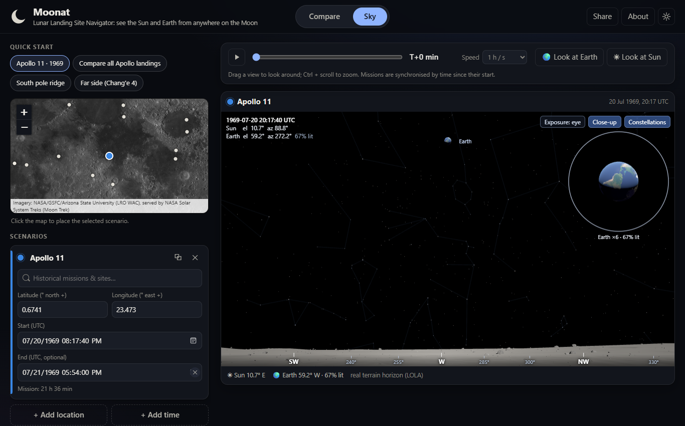
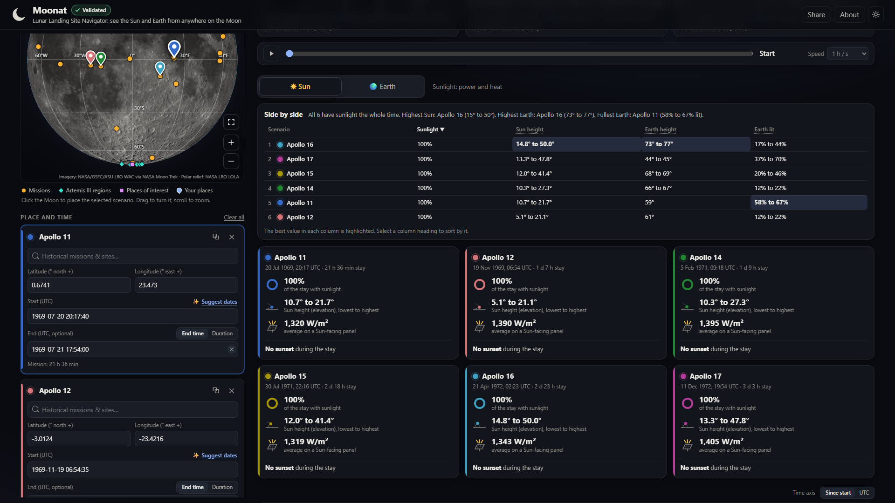
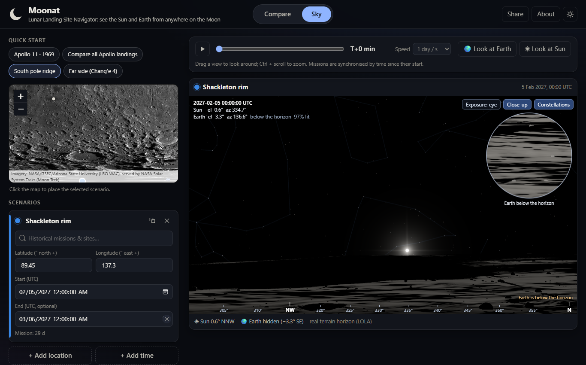
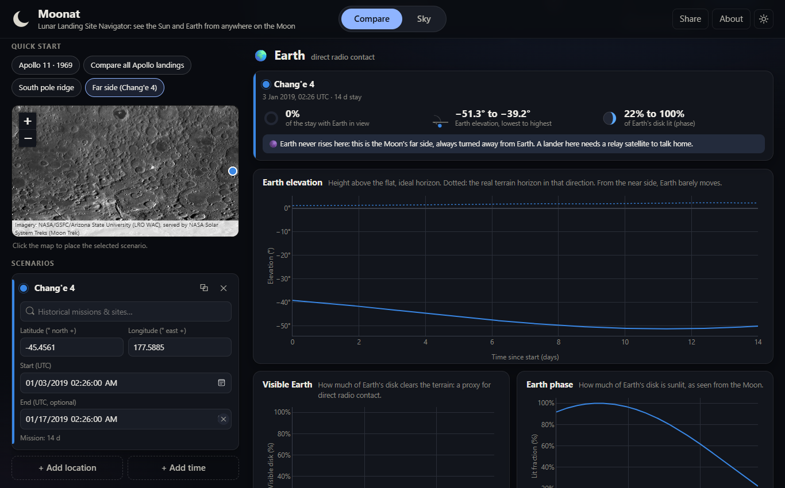

<!-- AI-generated with Claude Code (Anthropic), directed and reviewed by the Moonat team. -->
# Moonat: Lunar Landing Site Navigator

**See the Sun and the Earth from any point on the Moon, at any time, behind the real LOLA horizon.**


*Computed render (not an AI-generated image): Apollo 11 at touchdown, 1969-07-20 20:17 UTC. Sun 10.7° up in the east, Earth 59.2° up in the west.*

**Live app: <https://shmonat.github.io/Moonat-Navigator/>** · **30 s demo video:
<https://shmonat.github.io/Moonat-Navigator/video/moonat_demo.mp4>** · **Slides (PDF): <https://shmonat.github.io/Moonat-Navigator/slides/moonat_slides.pdf>** ([HTML](https://shmonat.github.io/Moonat-Navigator/slides/))

Our entry for NASA Space Apps Challenge 2026,
[Lunar Landing Site Navigator](https://www.spaceappschallenge.org/2026/challenges/lunar-landing-site-navigator/).
The Sun sets the power budget and the Earth sets the direct-to-Earth communication windows. A ridge or a crater rim
can hide either one. Moonat computes both against the real terrain and lets you compare sites and dates side by side.

## What it does
One page, in the order you need it:
1. **Place and time:** click the Moon globe (missions, with the flag of the nation that flew them, potential Artemis
   sites and places of interest are marked in their own colours), type coordinates or search 41 catalog sites
   (Apollo, Luna, Surveyor, Chang'e, Chandrayaan-3, the Beresheet crash site, potential Artemis sites), and give a time or a mission span in the date picker, where
   **Suggested for this place** proposes the windows with the most sunlight, the best Earth contact or both, and the
   eclipses and Earthrises seen from that place. Or start with a story: Apollo 11, all Apollo landings, the south pole,
   the far side, an eclipse, a rover drive, or the sky right now at the Beresheet crash site (Israel's first Moon
   mission, 2019), where its tardigrades lie.
2. **The sky from there:** a first-person 3D view from 2 m above the ground, with terrain lit by the Sun, the Earth with
   its true phase and orientation, stars and planets, and a timelapse; one view per scenario. The view fills the
   window like an app, with a full-screen button. While it plays, "Follow Sun" or "Follow Earth" keeps the body in
   frame. A hint offers the eclipse or the Earthrise a mission window holds ("Show me"). On the globe, a wedge at each
   place shows where its view is looking, and the globe shows day and night at the view's time.
3. **Sun | Earth:** one switch turns every view to the Sun or the Earth and shows that body's numbers: elevation,
   visible fraction of the disk, solar flux (W/m²) on a Sun-facing, fixed-tilt turning or flat panel, phase, time to sunset or Earthset, a side-by-side ranking of the
   scenarios, and charts with a cursor at the sky's moment.

More:
- **Eclipses seen from the Moon:** when the Earth crosses the Sun (a lunar eclipse on Earth), the share of sunlight it
  hides is computed and drawn, with the red ring of Earth's atmosphere; quick start "Eclipse from the Moon" replays
  Blue Ghost's 14 March 2025 view ([validation against NASA's contact times](docs/validation/eclipse.md)).
- **Rover trips:** switch on **Trip** next to a place and add an end point and stops, as in Google Maps directions
  (each leg up to 60 km); Moonat fetches LOLA terrain from NASA Moon Trek, finds the fastest drivable path for a
  VIPER-class rover or the Apollo LRV (slope limits), draws it on the globe, and charts the Sun and Earth along the
  drive against time or distance travelled. The travel time is coloured like traffic: green, orange or red by how much
  slower the route is than a straight drive on flat ground (detours and slopes). The timelapse rides along the route,
  with an optional "Driver's view" facing the way the rover drives ([validation](docs/validation/rover.md)).
- **Map layers:** NASA's permanently shadowed regions and the ground lit at least 70 % of the time, at both poles
  (NASA GSFC PGDA, Mazarico et al. 2011 method; [check](docs/validation/map_layers.md)).

| Compare all Apollo landings | South pole (Shackleton rim) | Far side (Chang'e 4) |
|---|---|---|
|  |  |  |

## How accurate is it?
Every claim below is backed by a validation report you can rerun.

| Check | Result | Report |
|---|---|---|
| Sun and Earth direction vs **JPL Horizons** (3 sites, 3 epochs, 399 rows) | max 0.055″ (target was 36″) | [ephem.md](docs/validation/ephem.md) |
| Browser tables vs Horizons (the exact code path the app uses) | Sun 0.049″, Earth 0.13″ at worst | [ephem.md](docs/validation/ephem.md) |
| Browser JavaScript vs Python reference | 3e-11° (ephemeris, 288 cases); visible fraction within 5e-14 (87 cases) | [physics.md](docs/validation/physics.md) |
| **Independent:** browser JavaScript directly vs **JPL Horizons**, no Python in between (20 random sites incl. both poles and the far side, 1966–2040; two eclipses; light time and aberration) | Sun 0.086″, Earth 0.124″ at worst (0.49″ inside the 2016 leap-second interval); all above 0.05″ explained | [independent_check.md](docs/validation/independent_check.md) |
| Disk-vs-horizon visibility vs analytic circular segment | max error 0.0025 | [physics.md](docs/validation/physics.md) |
| LOLA georeferencing: Shackleton floor, Apollo 11 ground | −2769 m (published −2.77 km); −1929.5 m (published −1926 m) | [terrain.md](docs/validation/terrain.md) |
| South-pole illumination vs **Gläser et al. 2014** (18.5 yr) | 92.7 % / 95.8 % lit at the 10 m point (published 92.5 % / 95.6 %); 86.0 % / 90.6 % at the 2 m point (published 88.1 % / 92 %) | [terrain.md](docs/validation/terrain.md) §5 |
| Malapert site search vs **Bussey et al. 2010** | 75.9 % Sun visibility in 2027 (published 74 % over a lunar year, point 2.5 km away) | [terrain.md](docs/validation/terrain.md) §9 |
| Ray-marched horizon vs independent 3-D point cloud | correlation 0.9995 / 0.9997, no azimuth mirroring | [terrain.md](docs/validation/terrain.md) §4 |
| Eclipse of the Sun by the Earth: whole-Moon contacts P1…P4 of 2025-03-14 and 1967-04-24 vs **NASA (Espenak)** | within 4.2 s; Blue Ghost's end of totality 08:34 UTC vs its diamond-ring photo "around 08:30" | [eclipse.md](docs/validation/eclipse.md) |
| Horizons for **custom points** (live LOLA from **NASA Moon Trek**: 20 m near the south pole, 30 m near the poles, 118 m elsewhere) vs the precomputed catalog horizons | 0.07–0.37° RMS at 10 of 12 sites (0.01–0.19° where the horizon is set beyond 5 km); Sun-visible time within 0–3.4 points at 5 polar sites. Until it arrives (1–5 s), or offline, a coarse tiles horizon labelled "approximate" is shown. | [terrain-everywhere.md](docs/validation/terrain-everywhere.md) |
| **Real Apollo photos:** terrain skyline of Hadley Delta, Mount Hadley (Apollo 15) and Stone Mountain (Apollo 16) vs Moonat's LOLA horizon (camera pointing fitted) | 0.08°, 0.09° and 0.15° RMS over 18–46° of azimuth | [real_photos.md](docs/validation/real_photos.md) |
| Sun and Earth vs the **Apollo Lunar Surface Journal** alt-az table (43 epochs, Apollo 11–17) | Sun altitude within 0.07°; Earth within 0.26°, or 0.08° in altitude and 0.12° in azimuth once the parallax that the table leaves out is removed | [real_photos.md](docs/validation/real_photos.md) |

Known limits: UT1 is taken as UTC, and the drawn Earth globe ignores precession and nutation (about 0.36° in 2026).
Neither affects Sun or Earth positions. Full lists are in the validation reports. Website QA: [qa.md](docs/validation/qa.md).

## How it works
1. **Positions:** JPL DE421 and the `MOON_ME` lunar frame (libration included), with light-time, aberration and
   gravitational deflection, rotated into the site's local east-north-up frame (no refraction on the Moon).
   Precomputed into compact tables (3 h step, 1966–1976 and 2013–2040) that the browser interpolates.
2. **Terrain:** for each catalog site, a horizon profile from NASA LOLA elevation maps: the highest elevation angle
   along every azimuth, on exact great-circle rays, including lunar curvature, out to 70–330 km.
3. **Visibility:** the Sun and Earth disks are sampled with 400 points. The fraction above the horizon gives the visible
   fraction, with Sun limb darkening for flux.
4. **Split of work:** heavy precomputation in Python (`src/moonat/`, validated against Horizons and the papers above).
   Light geometry in the browser (`web/js/physics/`, tested against the Python reference). Any other point gets real LOLA
   terrain on demand: `web/js/terrain/` (`terrainAt`) fetches it from NASA Moon Trek in a Web Worker and builds the horizon and
   the 3D ground in the browser ([research](docs/research/terrain-everywhere.md)).

## Data sources
NASA Space Apps challenge resources are marked "(challenge resource)". Full list with licences: [docs/REFERENCES.md](docs/REFERENCES.md).
- **JPL Horizons** (challenge resource): validation reference for Sun and Earth positions.
- **Moon Trek** (challenge resource): LRO WAC mosaic for the globe, and live LOLA elevation for any point and for rover routes.
- **LRO LOLA** (NASA PDS): polar DEMs LDEM_80S_20M, 75S_30M, 60S_60M, 75S_240M; global LDEM_64 and LDEM_16;
  SLDEM2015 (LOLA + SELENE) within ±60° latitude.
- **JPL/NAIF**: DE421 ephemeris, lunar orientation kernel and frame kernel.
- **NASA Visible Earth**: Blue Marble and Earth City Lights textures. Stars: Yale Bright Star Catalogue.

## Run locally
Requires [uv](https://docs.astral.sh/uv/) and git. First-time setup: [docs/SETUP.md](docs/SETUP.md).
```bash
git clone https://github.com/ShMonat/Moonat-Navigator.git && cd Moonat-Navigator
uv sync
uv run python -m http.server -d web 8123      # open http://localhost:8123
uv run pytest                                  # Python tests
node --test web/tests/                         # JavaScript tests (Node 20+)
```
The web app has no build step. Libraries (three.js, Plotly) load from a CDN.

## Repo map
```
web/                 the app: index.html, js/app (UI), js/physics, js/sky (3D view), data/ (tables, DEM tiles, catalog)
src/moonat/          Python package: ephem/ (DE421 + MOON_ME), terrain/ (LOLA horizons), visibility.py, metrics.py
scripts/             data builders and validation (build_ephem_tables.py, validate_ephem.py, data/build_terrain.py)
tests/               pytest tests and fixtures (including cached JPL Horizons responses)
docs/                vision, architecture, contracts, validation reports, references, AI use, submission texts
docs/figures/        screenshots and validation plots
```

## Team
- **Shay Monat**, team lead
- **Shahar**, team member

## Use of AI
AI coding agents (Claude Code by Anthropic) wrote most of the code, tests and docs. The team set the vision, the
architecture and the physics requirements, and reviewed the results. Every source file carries an AI-generated header.
Screenshots are computed renders, not AI-generated images. Details: [docs/AI_USE.md](docs/AI_USE.md).

## Licence
No licence file is included. All rights are reserved by the team unless stated otherwise. NASA data and third-party
libraries keep their own terms (see [docs/REFERENCES.md](docs/REFERENCES.md)).
