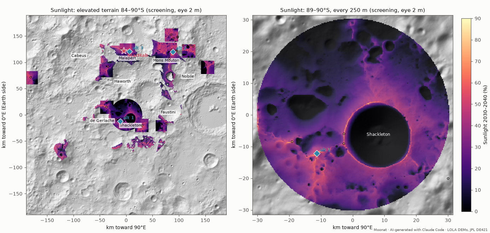
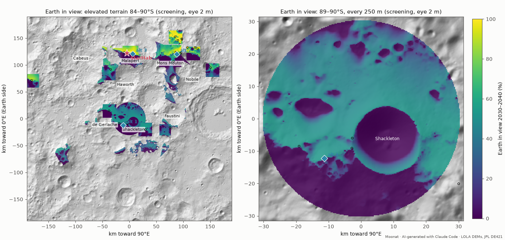
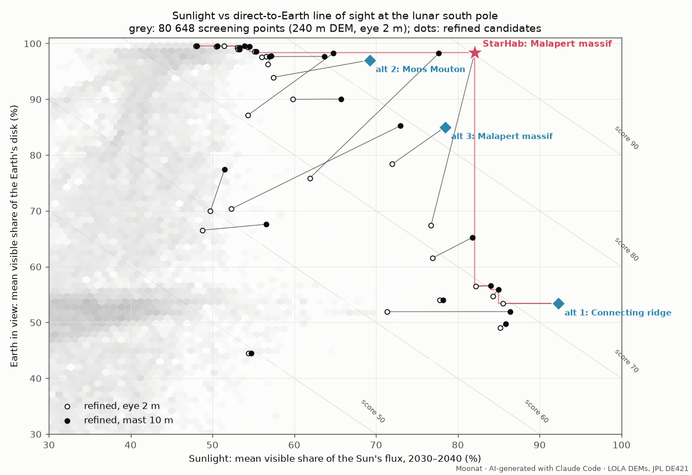
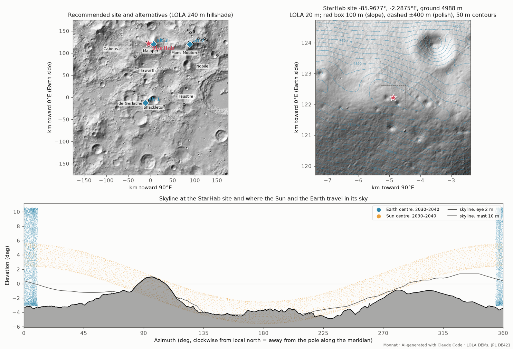

<!-- AI-generated with Claude Code (Anthropic), directed and reviewed by the Moonat team. -->
# Where should StarHab stand? Sunlight and Earth contact at the lunar south pole, 2030–2040

> Question (Shay): *"Can you use our tool to determine where's the best place for it? Maximum sunlight, maximum
> communication with Earth, for years starting from 2030."* StarHab = a horizontally placed, regolith-buried Starship HLS
> (Monat, IAC 2021). Physics domain: Shay. Code: `scripts/starhab/` (re-runnable, ~30 min on 6–14 processes):
> `screen.py` → `refine.py` → `report.py` → `validate.py`. Site file: `data/starhab_site.json`.
> Tests: `tests/test_starhab_geometry.py`.

## Answer
**Malapert massif, on the summit crest 9 km west of the catalog point of NASA's Artemis III "Malapert Massif" region: 85.96775° S, 2.28748° W
(MOON_ME lat −85.96775, lon −2.28748), ground +4988 m** (LOLA 20 m), 122 km from the pole on the Earth-facing side.
With the arrays and the direct-to-Earth (DTE) antenna at **10 m** (StarHab's buried 9 m hull is itself a ~10 m mound),
over 2030–2040:

- **Sun: 82.0 %** of the full solar flux on average (sunlit 85 % of the time); **longest night 7.0 days**.
- **Earth: 98.3 %** of its disk in view on average. Some of the Earth is visible **100 % of the time**, so there are **no blackouts**.
- **Sun and Earth together: 85 % of the time.** Whenever the Sun is up, the Earth is up too.

**How robust the choice is:** the site wins for any weight on sunlight from 5 % to 81 %. Above 82 % the connecting
ridge near Shackleton wins (alternative 1: 92 % Sun, but the Earth is hidden 42 % of the time, in blackouts of up to
12 days).

**Terrain:**
- **Slope:** 2.0° over a 100 m box (roughness 0.4 m RMS).
- **Permanent shadow:** NASA's 60 m map has a permanently shadowed pixel 190 m away (a micro cold trap). The nearest
  shadowed area of at least 1 km² is 13 km away.

## 1. Set-up and assumptions
- **Period:** 2030-01-01 to 2040-12-31 UTC, 1 h steps, which is where our browser ephemeris ends. 11 years is **0.59
  of the 18.6-year nodal cycle**.
  - **Sun:** the Sun's latitude in the lunar sky swings ±1.54° over the 346.6-day eclipse year (Cassini's laws), with a
    constant amplitude. Its phase against the 29.5-day synodic month (the Sun's azimuth) only repeats after about 18 years.
  - **Earth:** the libration pattern (27.21-day draconic month against the 27.55-day anomalistic month) repeats about
    every 6 years. 11 years covers it about 1.8 times.
  - **Expectation:** means should converge; extremes such as the longest night could be missed.
  - **Check:** we re-ran the four final sites over one full cycle (2022-05-01 → 2041-01-01, 18.67 yr). Every mean moved
    by **≤ 0.4 points**. The longest night and the longest blackout are **identical**. So the 11-year window is
    representative.
- **Why the south pole:**
  - **Water ice:** it lies in the permanently shadowed craters (LCROSS, Cabeus 2009).
  - **Missions:** all of NASA's Artemis III candidate regions are there.
  - **Light:** the near-continuously lit ridges are there.
  - **The north pole (footnote §5):** on the same coarse DEM, no north-polar point beats the south on either metric.
- **Physics:** the same chain as the app (CONTRACTS C1/C3/C6).
  - **Ephemeris:** skyfield + JPL DE421 + the lunar PA kernel. It gives the apparent Sun and Earth seen from the Moon's
    centre in MOON_ME, then each site subtracts its own position vector.
  - **Parallax:** that subtraction applies the topocentric parallax exactly. For the Earth it is up to 0.26°; at the pole
    it *lowers* the Earth by 0.26°, a test case.
  - **Horizon:** exact great-circle rays over a spherical Moon plus LOLA heights, from the eye (ground + 2 m or + 10 m).
  - **Disks:** the Sun is a limb-darkened disk (u = 0.6). The Earth is an opaque disk that also eclipses the Sun (75 h in
    11 years). Both disks are integrated with 400 points each. No refraction.
- **Metrics** (time averages; definitions in the site file):
  - **Sun %:** the mean visible share of the Sun's flux.
  - **Lit %:** the time with any sunlight.
  - **Longest night:** the longest stretch with no sunlight.
  - **Earth %:** the mean visible share of the Earth's disk.
  - **Any %:** the time with any part of the Earth visible (Mazarico's definition).
  - **Longest blackout:** the longest stretch with the Earth fully hidden.
  - **Both %:** the time with some Sun and some Earth.
  - **Score** = (Sun % + Earth %)/2.

## 2. Method (three passes)
1. **Screening (80 648 points).**
   - **Points:** every 250 m over 89–90° S, which is about one DEM pixel. Over 85–89° S, a 1 km grid keeping the top
     10 % of heights in each 0.5° latitude ring. And 500 m grids in boxes around Malapert, Mons Mouton (Leibnitz β) and
     its plateau, the Nobile rims, Haworth, de Gerlache, the Shackleton-vicinity peak, Cabeus B and Slater.
   - **Horizons:** LOLA 240 m, coarsened to 480/960/1920 m beyond 30/60/120 km, with LDEM_16 beyond the file. 1° azimuth
     step, eye 2 m.
   - **Visibility:** a straight-edge approximation of the visible disk fraction, every 2 h. It took 400 s on 14 processes.
   - Maps: Fig. 1 and 2.
2. **Refinement (27 candidates, ≥ 2 km apart).**
   - **Which candidates:** the 10 best by score, the 6 best by sunlight, 6 points of the Pareto front, and the best
     point of every area.
   - **Polish:** each candidate was searched ±400 m at 100 m with the **LOLA 20 m** near field (to 15 km), at 2 m and
     10 m. We kept the point with the best 10 m score.
   - **Final:** the full C3 horizon (0.25°) and the exact C6 visibility every hour. All four reported sites have
     complete 20 m coverage.
3. **Ranking:** by the score at 10 m. We show the Pareto front (Fig. 3) and a weight sweep instead of hiding the
   trade-off.

## 3. Results
Values are given as eye 2 m / mast 10 m.

| Site | lat, lon (MOON_ME) | Ground | Sun % | Lit % | Longest night (d) | Earth % | Any % | Longest blackout (d) | Both % | Score |
|---|---|---|---|---|---|---|---|---|---|---|
| **★ Malapert crest (recommended)** | −85.96775, −2.28748 | 4988 m | 76.7 / **82.0** | 82.3 / 85.1 | 13.0 / **7.0** | 67.4 / **98.3** | 73.1 / **100** | 8.4 / **0.0** | 57.1 / **85.1** | 72.1 / **90.2** |
| Alt 1: connecting ridge (Shackleton–de Gerlache) | −89.45281, −137.19807 | 1956 m | 85.5 / **92.3** | 90.3 / 95.7 | 4.8 / **3.0** | 53.4 / 53.4 | 58.2 / 58.3 | 12.3 / 12.3 | 52.8 / 57.4 | 69.4 / 72.8 |
| Alt 2: Mons Mouton, north flank | −85.08104, 36.32507 | 6793 m | 57.5 / 69.2 | 59.0 / 70.8 | 14.8 / 10.8 | 93.9 / **97.0** | 100 / 100 | 0 / 0 | 59.0 / 70.8 | 75.7 / 83.1 |
| Alt 3: Malapert east summit (next to the Artemis III region) | −86.01181, 2.94589 | 5142 m | 72.0 / 78.4 | 75.9 / 83.5 | 17.9 / 12.0 | 78.4 / 85.0 | 87.9 / 96.5 | 5.5 / 4.0 | 64.2 / 80.0 | 75.2 / 81.7 |
| *Shackleton rim (for context)* | −89.6866, −162.7124 | 1730 m | 85.2 / 85.8 | – | 2.8 / 2.7 | 49.1 / 49.8 | – | 13.5 / 13.2 | 49.4 / 50.2 | 67.1 / 67.8 |

The other 22 candidates are in `data/cache/starhab/report_table.md`, which `report.py` writes.

**Mast height at the recommended site** (2 → 3 → 5 → 7.5 → 10 → 15 → 20 m):
- **Sun:** 76.7 → 80.5 → 81.6 → 81.9 → 82.0 → 82.2 → 82.3 %.
- **Earth:** 67.4 → 71.2 → 79.2 → 94.2 → 98.3 → 98.4 → 98.4 %.
- **Longest blackout:** 8.4 → 7.3 → 4.9 → 0 d from 7.5 m.
- **What causes it:** at 2 m, a 4 m rise in the 20 m DEM 80 m to the north hides the low Earth.
- **What it means:** **mount at ≥ 7.5–10 m.** Above 10 m the gain is < 0.3 points.

At the connecting ridge, height buys sunlight (85.5 → 92.8 % at 20 m) but **never** Earth: the Earth is hidden by
distant terrain across the pole, so no mast helps.

*Fig. 1: screening sunlight (Sun %, eye 2 m, 240 m DEM). Left: elevated terrain 84–90° S. Right: 89–90° S every 250 m.
Rims and ridges glow, and the crater floors stay dark.*

*Fig. 2: screening Earth in view. Above 89° S at most ~60 %, and none on the far side of the pole. The Earth-facing
massifs at 85–86° S see the Earth almost all the time.*

*Fig. 3: sunlight against Earth in view. Grey: all screening points. Dots: refined candidates at 2 m (open) and 10 m
(filled). The red step is the 10 m Pareto front, and the diagonals are lines of equal score.*

*Fig. 4: the recommended site. Top: regional map, and the LOLA 20 m zoom with the 100 m slope box. Bottom: the skyline
at 2 m and 10 m, with every Sun and Earth position of 2030–2040. The Earth (blue, azimuth ~0°) always clears the 10 m
skyline. The Sun is lost when it passes over the pole side (azimuth ~180°) in winter, and briefly behind a peak at
azimuth ~95°.*

## 4. Recommendation and trade-offs
- **Why the Malapert crest wins:**
  - **Earth:** the site stands 5 km high at 86° S on the Earth-facing side. Toward the Earth (north, azimuth 0 ± 8°) its
    10 m skyline lies at −3.4°, while libration keeps the Earth's centre between −3.3° and +10.5° there.
  - **Sun:** across the pole side the skyline lies at −3.7° to −4.8°, and the Sun circles between −5.5° and +5.5°. The
    Sun is lost mainly in winter, when it passes low over the pole side (azimuth ~180°).
- **What it costs:** the longest night is 7 days, against 3 days on the connecting ridge. The worst night starts on
  2030-03-01 (southern winter). StarHab needs about **one week of energy storage** (or a second, phased array site)
  instead of ~3 days.
- **Alt 1, the connecting ridge (39 m from Gläser's spot 3):**
  - **Gains:** the best sunlight and the shortest night.
  - **Costs:** the Earth is in view only 58 % of the time: it is hidden for about 11 of every 27 days, in blackouts of
    up to 12.3 d. It needs a relay: a lunar relay satellite, or a repeater on an Earth-facing peak.
  - **Choose it** if energy matters about 4.5 times more than comms (weight sweep w_sun ≥ 0.82).
- **Alt 2, Mons Mouton:** the Earth is in view continuously, but the Sun only 69 % and the longest night is 11 days.
- **Alt 3, Malapert east summit:** it is 1 km from Bussey's point M1 and next to NASA's Artemis III Malapert region.
  - **Gains:** balanced numbers (Sun 78 %, Earth 85 %, both 80 %).
  - **Costs:** a rougher 100 m box (6° mean slope, 2 m RMS) and a 12-day night.
- **Siting tolerance:** the position matters at the 100 m scale. Across the ±400 m polish window around the
  recommended point, the 10 m score ranges from 17 to 90, because the crest is narrow and the south face drops steeply.
  Place the hull on the crest within ~100 m of the given point, and confirm the site with the 5 m LOLA / LROC NAC DEMs.
- **Terrain checks:**
  - **Slope:** the plane fit over 100 m gives a 2.0° tilt (mean per-pixel slope 2.6°, max 5.6°). That is about 2 m of
    height change along a 60 m hull, well within the excavation a buried hull needs anyway.
  - **Ice:** the nearest permanently shadowed region (PSR) of at least 1 km² is 13 km away (our own screening: 10 km).
    Micro cold traps (Hayne et al. 2021) lie within 0.2 km.
  - **Comparison:** the connecting ridge is 6 km from a ≥ 1 km² PSR.

## 5. Validation against the literature

| Check | Published | Moonat |
|---|---|---|
| Gläser 2014 (EPSC2014-136), connecting-ridge spot 3, 10 m, ~19 yr (ours 2021–2039) | 92.5 % average illumination, 95.6 % lit, longest dark 3.08 d | **92.6 %, 95.7 %, 3.04 d** |
| Gläser spot 4, 10 m | 91.9 %, 95.66 %, 3.17 d | **91.7 %, 95.7 %, 3.08 d** |
| Gläser spot 1 / 2, 2 m | 88.1 / 87.9 %, 92.0 / 92.3 % lit, 4.58 / 4.62 d | 85.6 / 85.2 %, 90.3 / 89.8 %, **9.6 / 11.2 d** |
| Bussey 2010, Malapert M1 (86.04° S, 2.7° E), 1 lunar year | 74 % | alt 3 (1 km away): 72.0 % (2 m) |
| Mazarico 2011, best Shackleton-rim point (240 m DEM, 6 h steps) | longest total darkness ~1.5 d | Shackleton rim (20 m DEM): 2.7–2.8 d |
| NASA PGDA Earth-visibility map (Mazarico method, 60 m, 18.6 yr, "any part of the disk"), 46 206 points at 89–90° S | – | median difference **+0.06 points**, r = 0.97 (5–95 %: −0.1 … +12) |
| NASA PGDA Sun map, the same points (share of time with any sunlight) | – | median +0.4 points, r = 0.95 (95th percentile +11) |
| De Rosa 2012: DTE windows near the Shackleton ridges | "a regular pattern of ~14 days" | connecting ridge: Earth in view 58 % of the time, blackouts ≤ 12.3 d |

**At 10 m we reproduce Gläser within 0.2 points and 0.1 days.**

**At 2 m:**
- **Average:** we are 2.5 points lower.
- **Longest night:** ours is 2× longer. The most likely cause is a 1–3 m bump in the near field (within ~100 m), at
  LOLA's noise level, that catches the grazing winter Sun.
- **Why it differs from Gläser:** Gläser used their own geometrically adjusted 20 m DTM.
- **Support:** Barker et al. (2021) found the same fragility with 100 DEM clones at these ridges (5 m DEM, 2024–2025).
  At 1 m height the 99th-percentile longest shadow is 13–22 d and the 1st-percentile average illumination 67–71 %. At
  5 m the average illumination rises to 83–89 %.
- **For StarHab:** 2 m statistics are DEM-noise-limited, which is one more reason to decide at mast height.

**PGDA maps:**
- **Height:** they appear to be at ground level. The label gives no height, but the strong pixel-to-pixel spread
  points to ground level (e.g. Gläser spot 3: 82 %, its 3 × 3 neighbourhood 45–86 %).
- **Effect:** our 2 m eye sees more where the near field matters.
- **Earth:** both maps agree closely. At the recommended site PGDA gives 64 % (3 × 3 px: 55–100 %), against ours
  73 % at 2 m and 100 % at 10 m. The same near-field effect is at work.

**North pole (footnote).** We ran the same screening on LOLA LDEM_16 (1.9 km, eye 2 m) for both caps, 85–90°.

| | South | North |
|---|---|---|
| Best score | Malapert (85.96° S, 3.6° W): Sun 80 %, Earth 98 % | 87.0° N, 7.8° E: Sun 74 %, Earth 78 % |
| Best Sun alone | 86.7 % | 84.6 % |
| Best Earth alone | 98.5 % | 80.9 % |

- **Result:** no north-polar point beats the south on either metric. The highest LDEM_16 point in 85–90° N is only
  1.5 km, against 6.7 km in the south, so the north has no Earth-facing massif like Malapert or Mons Mouton.
- **Consistent literature:** Gläser 2018 finds the best ground-level illumination on the Whipple rim (north, 82.9 %),
  but at 2 m the best is the south's connecting ridge (88.0 %).

## 6. Caveats
- **Line of sight is not a link budget.** "Earth in view" means the line of sight is clear. It ignores the following:
  - an antenna elevation mask (De Rosa: a 2° mask costs ≤ 5 %);
  - multipath at grazing angles;
  - which DSN complex sees the Moon.
- **DEM limits:**
  - LOLA 20 m heights are uncertain by ~1–3 m. Features narrower than ~250 m outside the polished neighbourhoods can be
    missed by the screening.
  - The screening uses straight-edge disk fractions without eclipses. Only the final numbers use the exact C6 model.
- **Not modelled:**
  - mutual shadowing between masts and arrays;
  - thermal environment, dust and a regolith-covered hull's own shape;
  - the operational weighting of power and comms (a transparent equal weight here; the weight sweep shows how far it
    can move).
- **Domain review:** the physics choices are Shay's to confirm. Ice access is reported as distance only (no
  ice-abundance data).
