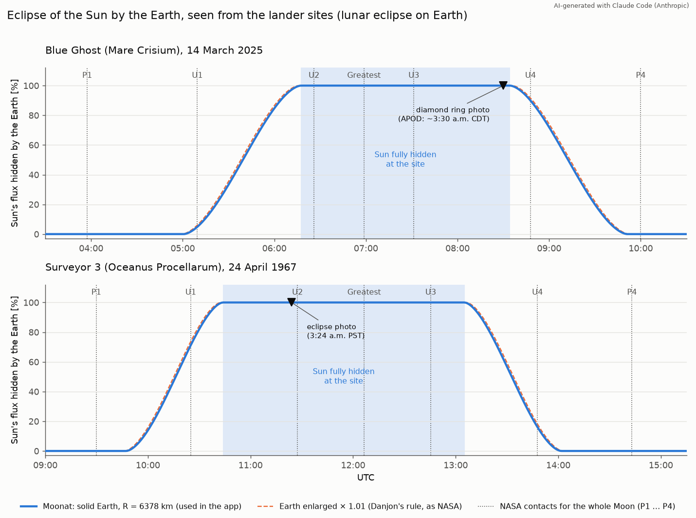
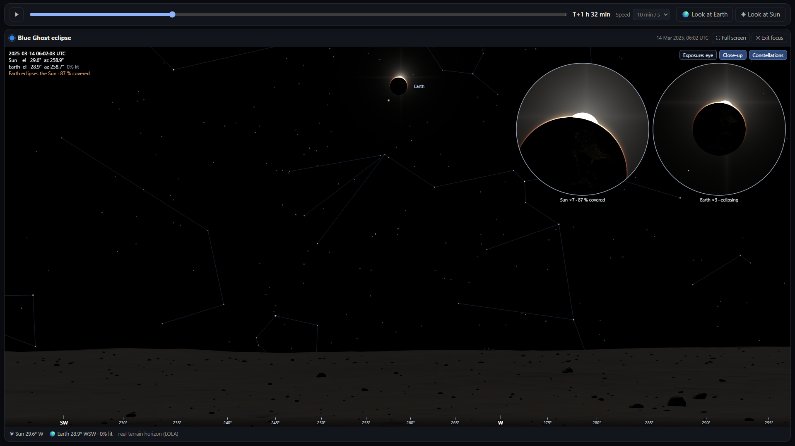
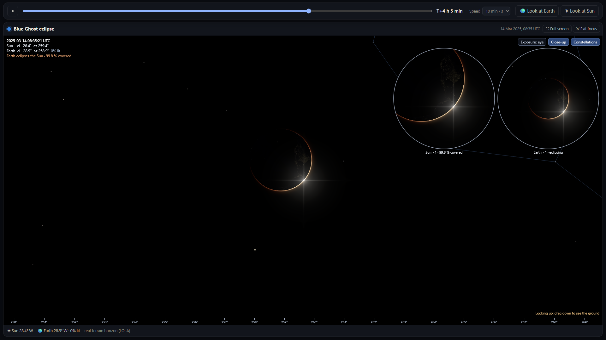
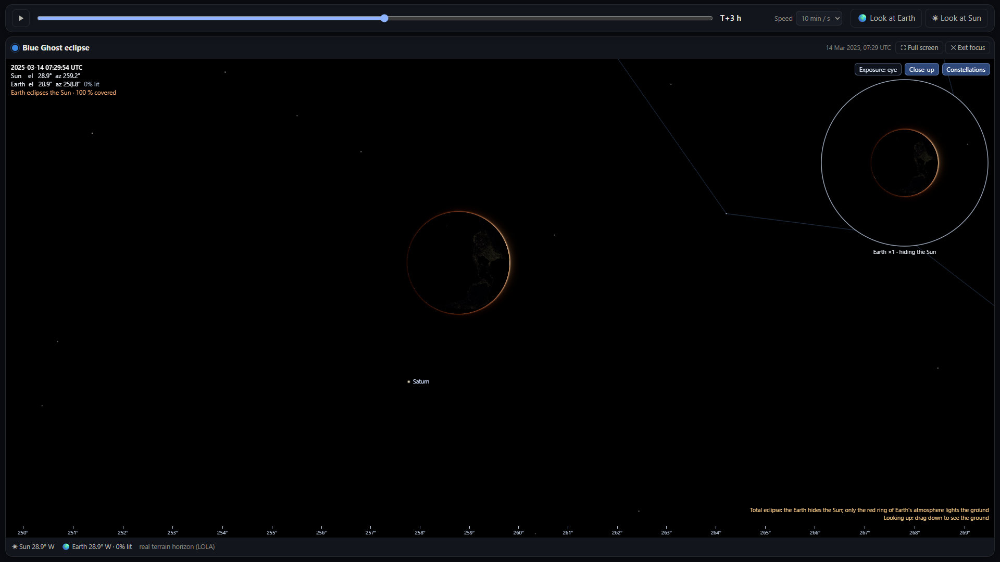

<!-- AI-generated with Claude Code (Anthropic), directed and reviewed by the Moonat team. -->
# Validation: the Earth eclipsing the Sun, seen from the Moon

When the Moon passes through the Earth's shadow (a lunar eclipse on Earth), an observer on the Moon sees the Earth
cross the Sun. Two landers photographed it: **Surveyor 3** on 24 April 1967 ("images of an eclipse of the Sun by the
Earth", NSSDCA) and **Blue Ghost Mission 1** on 14 March 2025 (its "diamond ring" frame is NASA's APOD of 19 March 2025,
taken "around 3:30 a.m. CDT", i.e. 08:30 UTC). This page checks our computation against NASA's eclipse predictions
(F. Espenak, NASA GSFC) and these photos.

Reproduce: `uv run python scripts/validate_eclipse.py` (tables below and the figure), `uv run pytest tests/test_eclipse.py`,
`node --test web/tests/physics_eclipse.test.mjs`.

## 1. What is computed
| Quantity | Where | Method |
|---|---|---|
| `sun.eclipse_frac` | `web/js/physics/eclipse.js` = `src/moonat/eclipse.py` | Share of the Sun's limb-darkened flux behind the Earth's disk. Both disks are circles on the sky at the apparent directions of the C1 table (light-time + aberration), radii asin(R/d). The solar disk is cut into rings; the covered arc of a ring is acos((r² + z² − p²)/(2rz)); rings fully behind the Earth are integrated analytically, the partly covered band with 24 Gauss–Legendre nodes. |
| `sun.flux_frac` | `index.js` | Terrain and Earth together: (1 − eclipse_frac) × the share of the un-eclipsed flux that clears the terrain (the 400-point disk sampling, with the Earth as an extra occulter). Equal to 1 − eclipse_frac when the whole disk clears the terrain, and to the old terrain-only value when there is no eclipse. `sun.vis_frac` stays terrain-only. |
| `series().eclipses` | `eclipse.js` `eclipseEvents` | First contact, totality start/end, greatest eclipse (minimum Sun–Earth separation) and last contact at the site, refined to 1 s by bisection / golden section. Events between samples are found (tested with a 6-hour step). |
| Whole-Moon contacts P1…P4 | `src/moonat/eclipse.py` `moon_shadow_contacts` | NASA's own method, with our ephemeris: angular distance of the Moon's centre from the shadow axis seen from the Earth's centre, against Danjon's radii Rp = 1.01 π_M + s_S + π_S and Ru = 1.01 π_M − s_S + π_S. |

**Occulting radius: the solid Earth, R = 6378.137 km** (IERS/WGS-84 equatorial; the same radius that sizes the Earth's
disk in the sky view, so the drawing and the numbers agree). **Decided by Shay, 2026-11-14:** the app keeps the solid
Earth; Danjon's enlarged Earth (below) is the documented alternative.
**Solar radius: R☉ = 695 700 km** (IAU 2015 Resolution B3 nominal, the value JPL Horizons uses; decided by Shay,
2026-11-14, in place of the earlier 696 000 km). It sizes the Sun's disk and enters the shadow radii as s☉.
Assumptions and what they change:
- **Atmosphere.** NASA enlarges the Earth's radius by 1/85 (an opaque layer about 75 km thick) and shrinks it by 1/594
  (oblateness at 45° latitude): factor 1.01, Danjon's rule ([NASA shadow page](https://eclipse.gsfc.nasa.gov/LEcat5/shadow.html)).
  The lower atmosphere really hides the Sun; its upper part bends sunlight into the shadow (the red ring of the photos).
  At the site, the 1.01 Earth makes the Sun disappear **64–87 s earlier** and reappear **64–87 s later**
  (table §3). The drawn red ring stands in for that light; it is not in `flux_frac`.
- **Oblateness.** The polar radius is 6356.752 km. Seen from the Moon the Earth's axis lies nearly in the plane of the
  sky, so the real limb is an ellipse with semi-axes ≈ 6378 and ≈ 6357 km. With R = 6356.752 km everywhere, the site
  contacts move by **≤ 30 s** (inward); the true effect depends on where the Sun crosses the limb and is smaller.
- **Plane of the sky.** The overlap uses flat geometry inside a 1.3° field: relative error ~ρ² ≈ 5e-4 in the covered
  fraction; contact times are exact (touching circles on the sphere have centre distance = sum or difference of radii).

## 2. Our ephemeris reproduces NASA's whole-Moon contacts (within 4.2 s)
NASA's times are UT = TD − ΔT with ΔT = 75 s (2025) and 38 s (1967), predicted in 2009. Ours are UTC with the true
TT − UTC = 69.184 s (2025) and 37.736 s (1967, USNO rubber-second UTC). The same instant therefore reads 5.8 s (2025)
and 0.3 s (1967) later in our UTC; the "diff" columns remove that shift. The last column repeats our computation with
the classical solar radius, R☉ = 696 000 km (semi-diameter 959.6″ at 1 au, Auwers' 959.63″), instead of the app's
IAU value.

**14 March 2025** ([NASA LE2025Mar14T](https://eclipse.gsfc.nasa.gov/LEplot/LEplot2001/LE2025Mar14T.pdf)). Umbral
magnitude: NASA 1.1784, ours 1.1789 (1.1786 with R☉ = 696 000 km).

| Contact | NASA (UT) | Moonat, whole Moon (Danjon) | diff − ΔT shift (+5.8 s) | diff with R☉ = 696 000 km |
|---|---|---|---|---|
| P1 | 03:57:24 | 03:57:29 | −0.9 s | −1.7 s |
| U1 | 05:09:33 | 05:09:37 | −2.3 s | −1.5 s |
| U2 | 06:25:59 | 06:26:01 | −4.2 s | −2.6 s |
| Greatest | 06:58:41.7 | 06:58:46 | −2.0 s | −2.0 s |
| U3 | 07:31:23 | 07:31:29 | +0.1 s | −1.3 s |
| U4 | 08:47:48 | 08:47:52 | −1.5 s | −2.4 s |
| P4 | 10:00:01 | 10:00:05 | −1.4 s | −0.5 s |

**24 April 1967** ([NASA LE1967Apr24T](https://eclipse.gsfc.nasa.gov/LEplot/LEplot1951/LE1967Apr24T.pdf)). Umbral
magnitude: NASA 1.3356, ours 1.3360 (1.3358 with R☉ = 696 000 km).

| Contact | NASA (UT) | Moonat, whole Moon (Danjon) | diff − ΔT shift (+0.3 s) | diff with R☉ = 696 000 km |
|---|---|---|---|---|
| P1 | 09:29:48 | 09:29:46 | −1.8 s | −2.5 s |
| U1 | 10:25:03 | 10:25:01 | −2.2 s | −1.5 s |
| U2 | 11:27:28 | 11:27:25 | −3.3 s | −2.3 s |
| Greatest | 12:06:26.3 | 12:06:25 | −1.6 s | −1.6 s |
| U3 | 12:45:24 | 12:45:24 | −0.2 s | −1.1 s |
| U4 | 13:47:49 | 13:47:48 | −1.4 s | −2.1 s |
| P4 | 14:43:05 | 14:43:05 | −0.7 s | −0.0 s |

With the app's R☉ = 695 700 km the contacts agree within **4.2 s**. The IAU Sun is 0.4″ smaller in semi-diameter,
so the umbra is 0.4″ wider and the penumbra 0.4″ narrower; that moves the contacts by 0.7–1.6 s (largest at U2/U3,
where the Moon crosses the umbra's edge obliquely). With the classical 696 000 km the agreement is **2.6 s**, so NASA's
tables fit the classical solar radius better. That remaining 0–2.6 s is the ephemeris (NASA: VSOP87/ELP2000-85; ours:
DE421) and constants (Moon radius 1737.4 km). All of it is far below the minute-level effects of the shadow model below.

## 3. What the lander saw: contacts at the site
NASA's contacts are for the **whole Moon**: U1 when the Moon's leading edge touches the umbra, U2 when its trailing edge
is in. A point on the Moon enters the umbra (the Sun disappears behind the Earth) somewhere **between U1 and U2**, and
leaves it **between U3 and U4**, depending on where it sits on the lunar disk. The Sun starts to be covered when the site
enters the *penumbra*, between P1 and P2 (P2 = the whole Moon inside the penumbra; computed, NASA does not list it).
So the totality at a site is longer than U2–U3 (the time the *whole* Moon is in the umbra), and the partial phases
match the penumbral contacts, not U1–U2.

**Blue Ghost** (18.562°N, 61.810°E, −3651 m): Mare Crisium is on the Moon's trailing edge in this eclipse, so it entered
the shadow late (near U2) and left it late (near U4). **Surveyor 3** (3.015°S, 23.418°W, −1424 m) is on the leading
half, so its contacts come earlier in each bracket.

| Blue Ghost, 14 March 2025 | Solid Earth (app) | Earth × 1.01 (Danjon) | NASA bracket (ours, UT) |
|---|---|---|---|
| Sun starts to be covered | 05:00:42 | 04:59:28 | P1 03:57:29 – P2 05:04:06 |
| Sun fully hidden (totality starts) | **06:17:24** | 06:15:57 | U1 05:09:37 – U2 06:26:01 |
| Greatest eclipse at the site | 07:25:54 | 07:25:54 | (Moon's centre: 06:58:46) |
| Sun reappears: diamond ring | **08:34:24** | 08:35:51 | U3 07:31:29 – U4 08:47:52 |
| Sun fully uncovered | 09:51:10 | 09:52:25 | P3 08:53:26 – P4 10:00:05 |

| Surveyor 3, 24 April 1967 | Solid Earth (app) | Earth × 1.01 (Danjon) | NASA bracket (ours, UT) |
|---|---|---|---|
| Sun starts to be covered | 09:47:24 | 09:46:20 | P1 09:29:46 – P2 10:27:46 |
| Sun fully hidden (totality starts) | **10:43:48** | 10:42:39 | U1 10:25:01 – U2 11:27:25 |
| Greatest eclipse at the site | 11:54:30 | 11:54:30 | (Moon's centre: 12:06:25) |
| Sun reappears | **13:05:13** | 13:06:21 | U3 12:45:24 – U4 13:47:48 |
| Sun fully uncovered | 14:01:39 | 14:02:43 | P3 13:45:05 – P4 14:43:05 |

Checks against the photos:
- **Blue Ghost's diamond ring**, "around 3:30 a.m. CDT" = 08:30 UTC (APOD): our end of totality is **08:34:24 UTC**
  (08:35:51 with the Danjon Earth). The diamond ring is the first sliver of the Sun at the end of totality, so the
  agreement is within the precision of "around".
- **Surveyor 3's eclipse picture**, "3:24 a.m. PST" = 11:24 UT (caption of JPL photo P-6586): inside our totality
  (10:43:48–13:05:13), when only the refracted ring of light around the Earth is visible. Shoemaker et al. (1968,
  JGR 73, 3989) describe "a bright region in the refraction halo" and bright beads in it in these pictures.

The greatest eclipse at a site (minimum Sun–Earth separation) differs from NASA's "greatest eclipse" (Moon's centre
closest to the shadow axis) by 12–27 min, because the site is up to one lunar radius away from the Moon's centre.

### In the app
Quick start **"Eclipse from the Moon"**: Blue Ghost, 14 March 2025, 04:30–10:20 UTC. The window is the site's partial
phases (05:00:42–09:51:10, set by the penumbral contacts at the site, not by U1/U4) plus about 30 min on each side; the
timelapse defaults to 10 min/s (35 s). Computed renders (Playwright + Edge, 1920 × 1080):

| Partial, 87 % covered (06:02 UTC), with the Sun close-up | Diamond ring at third contact (08:35:21) | Totality, the full red ring (07:30) |
|---|---|---|
|  |  |  |

**Compare tab.** The Sun card names the eclipse in its footer ("Earth eclipses the Sun: total for 2 h 17 min
(06:17–08:34 UTC), partly covered 05:00–09:51 UTC"); the terrain's sunset or sunrise follows only when one happens in the
window. "% of the stay with sunlight" counts samples with `flux_frac` > 0, so totality counts as dark. The **Visible
Sun** chart draws, as its solid line, the share of the Sun's light that reaches the site: C6 `flux_frac`, limb-darkened,
with both the terrain and the Earth in the way. When the window holds an eclipse, a dashed line adds the terrain alone
(C6 `vis_frac`, share of the disk), and a legend key says so. Outside eclipses the two differ only while the terrain
cuts the disk, by the limb-darkening weight (a thin crescent at the edge carries less light than its area).
This flux-weighted chart was approved by Shay (2026-11-14).

The ring is drawn, not computed as flux: bright and orange where the needed deviation δ (from the limb point to the
nearest point of the solar disk) is small, redder and fainter as δ grows, none beyond δ ≈ 1.2° (twice the horizontal
refraction). Its brightness law is a visual stand-in, chosen to look like the Blue Ghost and Surveyor 3 pictures.
**Decided by Shay, 2026-11-14:** keep the red ring, labelled as **illustrative** in the sky view. Its geometry (where
refracted light can reach) is physical; its brightness and colour are not a computation.

## 4. Tests
| Test | Reference | Result |
|---|---|---|
| Uniform disk vs analytic lens area (p = 0.1…3.9, z across the overlap) | exact geometry | max error **< 1e-8** (JS and Python) |
| Limb-darkened disk vs a 1601² Cartesian grid | independent integration | within 2e-3 (the grid's own error) |
| Sun covered at NASA's greatest eclipse and at the site's maximum, both sites | 100 % | **1.0 exactly**, flux 0, vis_frac 1 |
| Whole-Moon contacts vs NASA (both eclipses) | NASA tables | within **5 s** after the ΔT shift (actual ≤ 4.2 s); with R☉ = 696 000 km within 3 s (actual ≤ 2.6 s) |
| Site contacts inside the NASA brackets (both radii) | U1–U2, U3–U4, P1–P2, P3–P4 | yes (solid Earth up to 2 min late on entry, by design) |
| Non-eclipse dates (ordinary day, full Moon 2025-04-13, 2031, 1967-05-10) | 0 | **0 exactly** (no overlap work: separation > sum of radii) |
| Terrain + Earth together (a wall through the Sun's centre in the partial phase) | consistency | vis 0.5, 0 < flux < 1 − ecl |
| JS vs Python, 94 site states (real horizons and walls) | `tests/fixtures/eclipse_cases.json` | worst difference **6.6e-13** |
| JS series contacts vs Python | same | < 2 s (both refine to ~1 s) |
| Coarse 6-hour series vs 10-min series | same events | contacts within 2 s |

**Speed.** A 30-day series at 10-minute steps (4321 samples, real LOLA horizons, Node 26): Blue Ghost 3.8 → 4.2 ms,
Shackleton rim 14.2 → 14.4 ms, Apollo 11 2.8 → 2.9 ms (median of 9 runs, before → after). The overlap integral only runs
when the separation is below the sum of the radii (a few hours per year at a given site).

## 5. Decisions (Shay, 2026-11-14)
- **Occulting radius: the solid Earth, 6378.137 km**, for the flux and the totality times. Documented alternative:
  Danjon's Earth (radius × (1 + 1/85 − 1/594) = 1.01, NASA's shadow): the Sun hides 64–87 s earlier and reappears
  64–87 s later at the site (§3). An ellipse with the polar radius would move the contacts by ≤ 30 s (§1).
- **Solar radius: 695 700 km** (IAU 2015 Resolution B3 nominal, as JPL Horizons), in place of 696 000 km. Effect:
  site contacts move by ≤ 1 s, whole-Moon contacts by 0.7–1.6 s (§2); the Sun's angular radius now matches Horizons
  to 0.0002″ ([independent_check.md](independent_check.md)).
- **The red ring stays, labelled as illustrative.** The refracted light of the Earth's atmosphere is drawn but not
  added to the flux; it is a tiny fraction of sunlight (a totally eclipsed Moon is about 10⁻⁴ as bright as the full
  Moon, or fainter).
- **The flux-weighted Visible Sun chart** (§3, Compare tab) is approved.
