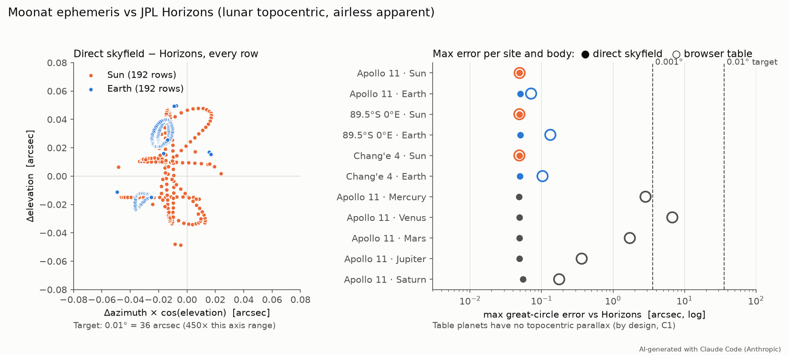

<!-- AI-generated with Claude Code (Anthropic), directed and reviewed by the Moonat team. -->
<!-- Generated by scripts/validate_ephem.py; do not edit by hand. -->
# Ephemeris validation against JPL Horizons

**Result: our Sun and Earth directions agree with JPL Horizons to 0.055 arcsec
(1.5e-05°) at worst over 399 rows. The target was 0.01° (36 arcsec).**

## What was compared
- **Ours (direct):** skyfield 1.55 + JPL DE421 + lunar frame `MOON_ME_DE421` (`moon_pa_de421_1900-2050.bpc`
  + `moon_080317.tf`). The observer is fixed on the Moon at radius 1737.4 km (+ height). We compute the
  apparent position (light-time, gravitational deflection, aberration) and rotate it into the site's
  ENU frame with a radial up vector. Code: `moonat.ephem.direct`.
- **Ours (table):** the browser tables `web/data/ephem/` (C1) + the topocentric transform in
  `moonat.ephem.table`, which is exactly what the JavaScript port does.
- **Horizons:** `CENTER='coord@301'`, `COORD_TYPE='GEODETIC'`, `SITE_COORD='E-lon,lat,0'`,
  `QUANTITIES='4,10,13,20,24'`, `APPARENT='AIRLESS'`, UT time scale. The cached responses are in
  `tests/fixtures/horizons/`, and `scripts/fetch_horizons.py` fetches them.

**Like-for-like check (from the Horizons response headers):** `Center pole/equ: MEAN_ME`. The Horizons manual says
this is the DE421 mean-Earth frame, realised from the DE440 PA frame with a fixed rotation. `Center radii: 1737.4, 1737.4, 1737.4 km`
means a sphere, so GEODETIC altitude = height above the 1737.4 km sphere and the zenith is radial,
exactly as in CONTRACTS §0. `Atmos refraction: NO (AIRLESS)`. The azimuth is clockwise from north. Horizons uses
DE441 and we use DE421. The difference is invisible at this level.

Sites: Apollo 11 (0.674°N, 23.473°E), south polar (89.5°S, 0°E), Chang'e 4 (45.44°S, 177.59°E).
Epochs: 1969-07-20 20:17, 2026-11-14 12:00 and 2030-06-01 00:00 UTC, plus a one-month series
(2026-11-14 → 12-14, every 12 h) per site and body. Planets: Apollo 11 at the three epochs.

## Maximum differences (ours − Horizons)
"Sky error" is the great-circle angle between the two directions. Unlike Δaz, it does not blow up near the zenith.

| method | body | rows | max sky error (arcsec) | max \|Δel\| (arcsec) | max \|Δdist\| | max \|Δdiam\| (arcsec) | max \|Δphase\| |
|---|---|---|---|---|---|---|---|
| direct | sun | 192 | 0.0490 | 0.0485 | 0.006 km | 0.000 | – |
| direct | earth | 192 | 0.0505 | 0.0497 | 0.001 km | 0.001 | 2.6e-05 |
| direct | mercury | 3 | 0.0484 | 0.0155 | 0.421 km | – | – |
| direct | venus | 3 | 0.0492 | 0.0174 | 0.041 km | – | – |
| direct | mars | 3 | 0.0492 | 0.0126 | 0.481 km | – | – |
| direct | jupiter | 3 | 0.0491 | 0.0486 | 165.452 km | – | – |
| direct | saturn | 3 | 0.0552 | 0.0470 | 172.256 km | – | – |
| table | sun | 192 | 0.0494 | 0.0485 | 1.090 km | 0.000 | – |
| table | earth | 192 | 0.1329 | 0.1317 | 0.177 km | 0.004 | 2.6e-05 |
| table | mercury | 3 | 2.8497 | 2.8495 | – | – | – |
| table | venus | 3 | 6.7563 | 6.7562 | – | – | – |
| table | mars | 3 | 1.7180 | 1.7178 | – | – | – |
| table | jupiter | 3 | 0.3647 | 0.3636 | – | – | – |
| table | saturn | 3 | 0.1767 | 0.1766 | – | – | – |

## The required epochs (Sun and Earth)
| site | body | UTC | Horizons az (°) | Horizons el (°) | Δaz·cos el (arcsec) | Δel (arcsec) | table Δsky (arcsec) |
|---|---|---|---|---|---|---|---|
| Apollo 11 | sun | 1969-07-20T20:17 | 88.80541 | 10.69751 | +0.0085 | -0.0160 | 0.0474 |
| Apollo 11 | sun | 2026-11-14T12:00 | 91.48573 | -7.06670 | -0.0320 | +0.0104 | 0.0335 |
| Apollo 11 | sun | 2030-06-01T00:00 | 87.77786 | -68.75162 | -0.0483 | +0.0066 | 0.0485 |
| Apollo 11 | earth | 1969-07-20T20:17 | 272.19423 | 59.22461 | -0.0165 | +0.0160 | 0.0408 |
| Apollo 11 | earth | 2026-11-14T12:00 | 277.58755 | 64.31995 | -0.0247 | -0.0120 | 0.0556 |
| Apollo 11 | earth | 2030-06-01T00:00 | 265.92461 | 65.75089 | -0.0492 | -0.0111 | 0.0514 |
| 89.5°S 0°E | sun | 1969-07-20T20:17 | 102.77534 | -1.41016 | +0.0160 | +0.0085 | 0.0468 |
| 89.5°S 0°E | sun | 2026-11-14T12:00 | 120.53444 | 1.30262 | -0.0104 | -0.0321 | 0.0337 |
| 89.5°S 0°E | sun | 2030-06-01T00:00 | 182.24117 | -0.67719 | -0.0046 | -0.0485 | 0.0487 |
| 89.5°S 0°E | earth | 1969-07-20T20:17 | 352.83995 | -1.45759 | +0.0155 | +0.0169 | 0.0767 |
| 89.5°S 0°E | earth | 2026-11-14T12:00 | 358.07806 | -3.62184 | -0.0147 | +0.0231 | 0.0529 |
| 89.5°S 0°E | earth | 2030-06-01T00:00 | 359.38503 | 1.30580 | -0.0076 | +0.0497 | 0.0538 |
| Chang'e 4 | sun | 1969-07-20T20:17 | 281.86143 | 9.65528 | +0.0057 | +0.0172 | 0.0474 |
| Chang'e 4 | sun | 2026-11-14T12:00 | 293.69254 | 23.62074 | +0.0129 | -0.0311 | 0.0342 |
| Chang'e 4 | sun | 2030-06-01T00:00 | 6.49414 | 44.19767 | -0.0085 | -0.0480 | 0.0490 |
| Chang'e 4 | earth | 1969-07-20T20:17 | 173.14701 | -46.23559 | +0.0168 | +0.0155 | 0.0531 |
| Chang'e 4 | earth | 2026-11-14T12:00 | 180.73234 | -48.59669 | -0.0148 | +0.0229 | 0.0278 |
| Chang'e 4 | earth | 2030-06-01T00:00 | 182.47401 | -43.65928 | -0.0091 | +0.0493 | 0.0520 |

## Findings
1. **UTC before 1972 matters.** skyfield assumes TAI−UTC = 10 s for every date before 1972. The official value on
   1969-07-20 was 7.57 s (the USNO "rubber second" formula). With skyfield's default, the 1969 Sun
   differs from Horizons by 3.4e-4° (1.2 arcsec). With the official formula (`moonat.ephem.direct.skyfield_time`) the difference is 6e-6°.
   So Horizons uses the official 1960s UTC, and so do we.
2. **Angular diameters:** we use R☉ = 695 700 km, the IAU 2015 Resolution B3 nominal value that Horizons uses
   (Shay's decision of 2026-11-14; with our earlier 696 000 km the Sun was 0.84 arcsec larger than Horizons').
   The Sun now agrees to 0.0005 arcsec and the Earth (6378.137 km) to
   0.0009 arcsec (Horizons prints the diameter to 0.001 arcsec).
3. **Distances:** Sun within 6 m and Earth within 0.7 m (light-time range).
   For Jupiter and Saturn, the 170 km difference comes from the DE421 system barycentre that we use. This is below 0.1 arcsec.
4. **Table planets** are unit vectors from the Moon's centre (C1). They have no topocentric parallax, so the error is up to
   6.8 arcsec for Venus near Earth. That is far below one pixel in the sky view.
5. **Phase:** illuminated fraction (1+cos α)/2 agrees with Horizons' `Illu%` within 2.6e-05.

## Table interpolation (C1)
Step 3.0 h, years 1966–1976 and 2013–2040,
16.0 MB. Cubic Hermite with finite-difference tangents
(central inside each file, third-order one-sided at the file edges) and slerp for the rotation. The
exact recipe is in `manifest.json` and `moonat.ephem.table`. Measured against direct skyfield
(4134 times, including the first and last interval of every year):
Sun 0.523", Earth 0.060", rotation 0.510".
The largest values come from the one 3-hour interval that holds the 2016-12-31 leap second: POSIX/JS
time cannot represent 23:59:60, so there is up to 1 s of lunar rotation (0.55") in that interval. Elsewhere the Sun is within 0.1".
The topocentric az/el from the table agree with direct skyfield within 3e-5° (200 random sites and times,
`tests/test_ephem_table.py`).

## Known approximations (for the consumers)
- `era_deg` uses UT1 = UTC (error < 0.9 s, < 0.004°). The Earth body frame `R_icrs_to_enu · Rz(era)` (C6)
  ignores precession and nutation since J2000. This is about 0.36° in 2026 and −0.43° in 1969 on the Earth's
  rendered orientation. That is fine for a texture, but it is not an ephemeris quantity.
- Inside each 3-hour table interval, a leap second gives an error of at most 0.55" (see above).
