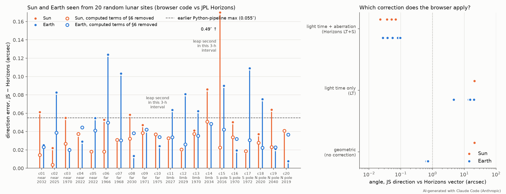

<!-- AI-generated with Claude Code (Anthropic), directed and reviewed by the Moonat team. -->
<!-- Generated by scripts/validate_horizons_js.py --write; do not edit by hand. -->
# Independent check: the browser physics against JPL Horizons

**Result: over 20 random sites and times, the code that runs in the browser (`web/js/physics`)
agrees with JPL Horizons to 0.086″ for the Sun and 0.124″
for the Earth (great-circle direction error, worst case; RMS 0.047″ and
0.065″). One case inside the 3-hour table interval that holds the
2016 leap second reaches 0.49″, as ephem.md predicted. We computed every term above the
ephemeris floor from first principles (§6). With those terms removed, both bodies agree to
0.051″. That equals the 0.05″ DE421-vs-DE441 floor of
the Python pipeline. No bug was found. The requirement was 36″ (0.01°).**



*Left: direction error per case. Hollow circles show the same case after the computed terms of §6 are
removed (table interpolation and leap seconds for the Sun, the centre-to-site term for the Earth).
Right: angle between the browser's direction and three Horizons vector types. The browser matches
"light time + aberration" to below 0.1″. For the Sun it is ~20″ away from the other two.*

## 1. Why this check
The earlier reports compare our Python pipeline (skyfield) with Horizons ([ephem.md](ephem.md)), and the
browser JavaScript with the Python pipeline ([physics.md](physics.md)). A shared mistake in both of our
implementations would pass both checks. Here the browser code is compared **directly** with Horizons,
with no Python ephemeris code in between. The harness was written from scratch: it does not use
`moonat.ephem.horizons` or `scripts/fetch_horizons.py`.

## 2. Method
- **Moonat side:** Node runs [`scripts/xcheck_skystate.mjs`](../../scripts/xcheck_skystate.mjs), which
  calls the public C6 API: `loadEphem` on the shipped tables `web/data/ephem`, `makeSite`, `skyState()` and
  `series()` (a one-sample window). `series()` equals `skyState()` in all 20 cases (largest difference 0°).
- **Horizons side:** the Horizons API, observer table, `CENTER='coord@301'`, `APPARENT='AIRLESS'`,
  `QUANTITIES='4,10,13,20,21,24'` (apparent az/el, illuminated fraction, angular diameter, range and range
  rate, one-way light time, S-T-O), `TIME_TYPE='UT'`, a time list (`TLIST`), `EXTRA_PREC='YES'`. For §5 also
  vector tables (ICRF, km and km/s) with `VEC_CORR` = `NONE`, `LT` and `LT+S`, and the Moon's barycentric
  state. Horizons uses DE441; our tables use DE421.
- **Convention matching.**
  - *Site:* we write (lat, lon) with east longitude in −180…180°. Horizons wants **longitude first**, east
    longitude 0…360°: `SITE_COORD='E-lon,lat,alt'` with `COORD_TYPE='GEODETIC'`, or `'E-lon,Dxy,Dz'` with
    `COORD_TYPE='CYLINDRICAL'`. The 6 polar cases (|lat| > 85°) use the cylindrical form, with
    Dxy = r·cos(lat), Dz = r·sin(lat) and r = 1737.4 km + height.
  - *Frame and figure:* every response header says `Center pole/equ : MEAN_ME {East-longitude positive}` and
    `Center radii : 1737.4, 1737.4, 1737.4 km`. MEAN_ME is the DE421 mean-Earth frame, i.e. our
    `MOON_ME_DE421`. Horizons' Moon is a sphere, so geodetic = geocentric, the zenith is radial and the
    altitude is the height above the 1737.4 km sphere, as in CONTRACTS §0.
  - *Height:* Horizons altitude = ground height + the 2 m eye height of C6. The case heights are random in
    ±4 km.
  - *Check:* Horizons echoes the site it used (`Center geodetic`). For all 44 observer responses,
    the echo matches the intended site: largest differences 0° in latitude, 0° in longitude and
    0 mm in height. The test asserts this, and asserts the MEAN_ME, sphere and airless flags.
  - *Time:* Horizons UT is UTC after 1962 (the official "rubber-second" UTC before 1972). JS uses POSIX
    milliseconds of the same UTC label.
- **Cases** (`make_cases`, `random.Random(20261115)`): 5 near side, 5 far side, 4 limb, 3 south polar,
  3 north polar; times drawn per kind: 3 at an exact 3-hour table node, 3 at mid-interval (node + 1 h 30 min),
  5 in the first or last interval of a year file (1966 start, 1971 end of the rubber-second era, 1975 and
  2016 with a leap second, 2040 end of the tables), 3 random in 1966–1976, 6 random in 2013–2040.
- **Cache:** the 75 Horizons responses are in `tests/fixtures/horizons_cache/` (one small JSON per
  query with the exact parameters; the text after `$$EOE` is dropped). Queries were sequential, 1 s apart.

## 3. Results for the 20 cases
"Δsky" is the great-circle angle between the two directions. "Δr" is the range difference: JS
`dist_km` minus Horizons `delta`.

| case | site | lat (°) | lon (°E) | height (m) | UTC | time kind | Sun Δsky (″) | Earth Δsky (″) | Sun Δr (km) | Earth Δr (km) | Earth Δphase |
|---|---|---|---|---|---|---|---|---|---|---|---|
| c01 | near | -40.9265 | 1.9044 | 2230 | 2032-12-06 11:37:38 | random | 0.061 | 0.025 | -0.456 | -0.1004 | -2.3e-05 |
| c02 | near | -19.1715 | 60.4810 | -2891 | 2025-11-29 07:44:48 | random | 0.022 | 0.083 | -1.668 | -0.0274 | +1.1e-05 |
| c03 | near | 53.3558 | -45.3939 | -3651 | 1970-09-01 02:08:06 | random | 0.055 | 0.021 | -1.295 | +0.0631 | -1.6e-06 |
| c04 | near | -16.7977 | 7.7076 | 2170 | 2022-02-06 22:28:52 | random | 0.037 | 0.029 | -1.885 | -0.1621 | -1.2e-05 |
| c05 | near | 11.3621 | -16.9284 | 3251 | 2022-02-11 03:00:00 | 3-h node | 0.018 | 0.055 | -0.177 | -0.1706 | +2.2e-05 |
| c06 | far | 28.5979 | -112.4066 | 1114 | 1966-01-01 01:20:04 | year boundary | 0.053 | 0.124 | +1.664 | -0.0028 | +1.1e-05 |
| c07 | far | 55.6211 | 161.9050 | 2871 | 1968-08-03 16:30:00 | mid-interval | 0.031 | 0.103 | -1.705 | +0.0955 | +1.9e-05 |
| c08 | far | -46.4443 | 174.2972 | -1977 | 2030-02-06 08:39:22 | random | 0.058 | 0.013 | -0.069 | +0.0784 | -2.3e-05 |
| c09 | far | 18.2733 | -128.4111 | -1501 | 1971-12-31 23:01:40 | year boundary | 0.047 | 0.041 | +1.662 | -0.1302 | -1.5e-06 |
| c10 | far | 40.7174 | -150.4869 | 1506 | 1975-12-31 21:56:41 | year boundary (leap s) | 0.038 | 0.024 | -0.639 | +0.0433 | +6.9e-06 |
| c11 | limb | 15.5953 | -86.5776 | -1018 | 2027-02-10 04:30:00 | mid-interval | 0.033 | 0.064 | -1.613 | +0.1050 | -2.3e-05 |
| c12 | limb | 53.8909 | 92.1386 | -1670 | 2029-01-08 12:00:00 | 3-h node | 0.020 | 0.081 | -0.012 | -0.0143 | +8.4e-06 |
| c13 | limb | 19.9379 | 92.0593 | 2529 | 1970-07-16 04:45:52 | random | 0.041 | 0.062 | -1.539 | +0.1422 | +2.3e-05 |
| c14 | limb | -37.8117 | -83.7716 | 2871 | 2034-12-25 09:38:54 | random | 0.086 | 0.049 | -0.898 | -0.1456 | -5.4e-07 |
| c15 | south polar | -86.1680 | 138.2585 | 3801 | 2016-12-31 23:59:30 | year boundary (leap s) | 0.490 | 0.090 | +0.502 | -0.0367 | -2.1e-05 |
| c16 | south polar | -85.2329 | -79.3389 | -2446 | 1970-05-19 19:16:45 | random | 0.050 | 0.019 | -1.786 | -0.0106 | +1.4e-05 |
| c17 | south polar | -86.3969 | 124.3902 | 469 | 1972-01-10 21:00:00 | 3-h node | 0.019 | 0.109 | -0.008 | -0.0142 | +1.7e-05 |
| c18 | north polar | 89.5615 | 37.6382 | 834 | 2020-01-18 14:46:56 | random | 0.037 | 0.075 | -0.154 | -0.0004 | +1.0e-05 |
| c19 | north polar | 87.1358 | 111.6112 | -505 | 2040-12-31 21:17:07 | year boundary | 0.064 | 0.021 | +0.084 | -0.0008 | +1.8e-05 |
| c20 | north polar | 86.9746 | 41.6435 | -3820 | 2019-08-18 10:30:00 | mid-interval | 0.041 | 0.008 | -1.774 | +0.0129 | -2.2e-05 |

| quantity (JS − Horizons) | unit | max \|Δ\|, 20 cases | RMS, 20 cases | max \|Δ\| without the 2 leap-second intervals |
|---|---|---|---|---|
| Sun direction (great circle) | arcsec | 0.490 | 0.118 | 0.086 |
| Sun Δaz·cos el | arcsec | 0.490 | 0.116 | 0.083 |
| Sun Δel | arcsec | 0.051 | 0.026 | 0.051 |
| Sun direction, interpolation term removed (§6.1, §6.3) | arcsec | 0.051 | 0.030 | 0.051 |
| Earth direction (great circle) | arcsec | 0.124 | 0.065 | 0.124 |
| Earth Δaz·cos el | arcsec | 0.041 | 0.024 | 0.041 |
| Earth Δel | arcsec | 0.117 | 0.060 | 0.117 |
| Earth direction, centre-to-site term removed (§6.2) | arcsec | 0.050 | 0.036 | 0.050 |
| Sun distance | km | 1.885 | 1.215 | 1.885 |
| Sun distance, explained terms removed (§6.3) | km | 0.170 | 0.060 | 0.170 |
| Earth distance | km | 0.1706 | 0.0891 | 0.1706 |
| Earth distance, explained terms removed (§6.4) | km | 0.0108 | 0.0048 | 0.0108 |
| Sun angular radius, as computed | arcsec | 0.422 | 0.417 | 0.422 |
| Sun angular radius, same R☉ | arcsec | 0.0000 | 0.0000 | 0.0000 |
| Earth angular radius | arcsec | 0.0017 | 0.0008 | 0.0017 |
| Earth illuminated fraction | – | 2.3e-05 | 1.6e-05 | 2.3e-05 |
| Sun light time (distance / c) | ms | 0.0065 | 0.0041 | 0.0065 |
| Earth light time (distance / c) | ms | 0.00082 | 0.00039 | 0.00082 |

Also: `series()` = `skyState()` for az, el and phase (largest difference 0°).

## 4. Eclipses: Sun–Earth separation at the lander sites
The instants are the site contacts of [eclipse.md](eclipse.md) §3 (Blue Ghost, 18.562°N 61.810°E, −3651 m;
Surveyor 3, 3.015°S 23.418°W, −1424 m), plus one instant before and one after. Horizons' separation
is the angle between its apparent Sun and Earth az/el. The "contact margin" is the separation minus
ρ☉ + ρ⊕ (C1, C4) or ρ⊕ − ρ☉ (C2, C3). Both sides use our radii: R☉ = 696000 km and R⊕ = 6378.137 km
(Horizons' Earth radius is the same).

| eclipse | instant | UTC | separation, Horizons (°) | separation, JS (°) | Δ (″) | JS eclipse_frac | contact margin JS / Horizons (″) |
|---|---|---|---|---|---|---|---|
| Blue Ghost, 2025-03-14 | before | 04:30:00 | 1.406951 | 1.406952 | +0.004 | 0.0000 | – |
| Blue Ghost, 2025-03-14 | C1 Sun starts to be covered | 05:00:42 | 1.179865 | 1.179854 | -0.040 | 0.0000 | -0.370 / -0.331 |
| Blue Ghost, 2025-03-14 | C2 totality starts | 06:17:25 | 0.644803 | 0.644813 | +0.037 | 1.0000 | -0.176 / -0.214 |
| Blue Ghost, 2025-03-14 | greatest at the site | 07:25:54 | 0.369580 | 0.369579 | -0.002 | 1.0000 | – |
| Blue Ghost, 2025-03-14 | C3 diamond ring | 08:34:23 | 0.644330 | 0.644341 | +0.040 | 1.0000 | -0.148 / -0.189 |
| Blue Ghost, 2025-03-14 | C4 Sun fully uncovered | 09:51:11 | 1.178917 | 1.178902 | -0.052 | 0.0000 | -0.017 / +0.034 |
| Blue Ghost, 2025-03-14 | after | 10:20:00 | 1.391385 | 1.391381 | -0.017 | 0.0000 | – |
| Surveyor 3, 1967-04-24 | before | 09:30:00 | 1.456334 | 1.456355 | +0.077 | 0.0000 | – |
| Surveyor 3, 1967-04-24 | C1 Sun starts to be covered | 09:47:23 | 1.289238 | 1.289259 | +0.076 | 0.0000 | +0.110 / +0.034 |
| Surveyor 3, 1967-04-24 | C2 totality starts | 10:43:48 | 0.760263 | 0.760256 | -0.024 | 1.0000 | -0.005 / +0.020 |
| Surveyor 3, 1967-04-24 | greatest at the site | 11:54:30 | 0.304180 | 0.304179 | -0.003 | 1.0000 | – |
| Surveyor 3, 1967-04-24 | C3 Sun reappears | 13:05:13 | 0.759930 | 0.759916 | -0.052 | 1.0000 | +0.146 / +0.198 |
| Surveyor 3, 1967-04-24 | C4 Sun fully uncovered | 14:01:39 | 1.288444 | 1.288459 | +0.052 | 0.0000 | -0.202 / -0.254 |
| Surveyor 3, 1967-04-24 | after | 14:30:00 | 1.560999 | 1.561017 | +0.065 | 0.0000 | – |

The separation agrees within **0.077″**. At the contacts the separation changes by 0.38–0.58″/s,
so the JS and Horizons geometries give the same contact times within **0.13 s**. The JS
margins are within ±0.4″ of zero, because the contact times in eclipse.md are rounded to 1 s. This check
covers the geometry only. The shadow model (solid Earth or the Danjon 1.01 enlargement) is discussed in
eclipse.md.

## 5. Light time and aberration
For one case of each site kind, Horizons gives the vector from the site to the body in three forms:
geometric (`NONE`), corrected for light time only (`LT`), and corrected for light time and stellar
aberration (`LT+S`, the apparent direction). The JS direction is rotated to ICRS with its own
`r_icrs_to_enu`.

| case | body | JS vs LT+S (″) | JS vs LT only (″) | JS vs geometric (″) | Horizons LT+S vs geometric (″) | v⊥/c theory (″) | light time Horizons / JS (s) |
|---|---|---|---|---|---|---|---|
| c01 (near, 2032) | sun | 0.051 | 20.36 | 20.362 | 20.311 | 20.311 | 490.810060 / 490.810059 |
| c01 (near, 2032) | earth | 0.038 | 13.81 | 0.733 | 0.725 | 0.725 | 1.234743 / 1.234742 |
| c06 (far, 1966) | sun | 0.069 | 21.07 | 21.080 | 21.011 | 21.011 | 490.928581 / 490.928587 |
| c06 (far, 1966) | earth | 0.081 | 4.86 | 0.617 | 0.685 | 0.685 | 1.310975 / 1.310975 |
| c11 (limb, 2027) | sun | 0.003 | 20.26 | 20.266 | 20.267 | 20.267 | 491.377508 / 491.377503 |
| c11 (limb, 2027) | earth | 0.055 | 15.18 | 0.635 | 0.688 | 0.688 | 1.309631 / 1.309631 |
| c16 (south polar, 1970) | sun | 0.023 | 20.90 | 20.909 | 20.931 | 20.931 | 506.133931 / 506.133925 |
| c16 (south polar, 1970) | earth | 0.028 | 20.13 | 0.711 | 0.710 | 0.710 | 1.274332 / 1.274332 |
| c18 (north polar, 2020) | sun | 0.037 | 20.73 | 20.721 | 20.684 | 20.684 | 490.618037 / 490.618037 |
| c18 (north polar, 2020) | earth | 0.096 | 4.65 | 0.720 | 0.719 | 0.718 | 1.251286 / 1.251286 |

- The browser matches **LT+S**: Sun 0.003–0.069″, Earth
  0.028–0.096″.
- **Sun:** with light time only, the error would be 20.3–21.1″. That is the stellar
  aberration v/c from the Moon's ~30 km/s barycentric velocity. So aberration is applied.
- **Earth:** the light time is 1.235–1.311 s (JS range / c agrees with Horizons' light
  time to 0.8 µs). Light time alone moves the Earth by the Earth's own
  barycentric motion during those 1.3 s, i.e. ~40 km, which is 4.7–20.1″ depending on the
  geometry. Aberration moves it back. The two nearly cancel, so apparent and geometric differ by only
  0.69–0.72″. That is the first-order "planetary aberration" v⊥/c, with v the
  Earth's velocity relative to the site (column "v⊥/c theory", from Horizons' geometric state; it agrees
  with Horizons' own LT+S − geometric to 0.001″). The browser shows the same 0.6–0.7″ offset from the
  geometric direction. Both corrections are therefore applied with the right sign and size.

## 6. Differences above the ephemeris floor, explained
1. **Leap-second interval (c15, Sun 0.490″).** The tables are indexed in POSIX time,
   which has no 23:59:60. The interval 2016-12-31 21:00–24:00 lasts 10801 s but is interpolated as
   10800 s. At 23:59:30 the browser is therefore 0.997 s ahead. In that time the Sun moves
   0.51″ across the lunar sky. The circle model of item 3, which includes the leap second, predicts
   0.505″ along the Sun's path (observed 0.490″; residual
   0.023″). The Earth is nearly fixed in the Moon's frame (synchronous rotation), so
   it is hardly affected. Only its range changes, by its rate × slip. This is the known limit in ephem.md
   ("up to 0.55″" in such intervals; there are 8 such intervals in the table years).
2. **Earth elevation, up to 0.117″: the "centre-to-site" term.** The C1 tables store the
   apparent vector from the Moon's **centre**. Its direction includes aberration, but its length is the light-time
   distance |A|. To first order the exact apparent vector is A + v·τ (v = observer barycentric velocity,
   τ = |A|/c). Fixing the length to |A| shortens it by (û·v/c)·|A|, up to ~38 km for the Earth.
   `skyState` then subtracts the site vector (1737 km). This turns the length error into a direction error
   (û·v/c)·sin p, where p is the topocentric parallax (up to 0.26° for the Earth). The result is a pure
   **elevation** error of at most 1e-4 × 4.5e-3 rad = 0.09″. Together with the ~0.05″ floor of item 7, this
   gives the observed 0.117″. For the Sun, p is 1.2e-5 rad, so the term is below 1e-6″.
   We computed the term for each case from the Moon's barycentric velocity (Horizons). It correlates with
   the observed Earth Δel (r = 0.89). Removing it lowers the Earth error from
   0.124″ to **0.050″** max (RMS 0.065″
   → 0.036″). This approximation is part of the table design. It is about
   1/70000 of the Earth's apparent diameter. It is not a bug.
3. **Sun: table interpolation (direction ≤ 0.07″, distance −1.9…+1.7 km).** In MOON_ME the Sun circles the
   Moon once per synodic month at 1 au, so the table components are sinusoids with θ = 1.52° per 3-hour
   step. A cubic Hermite with finite-difference tangents cuts inside such a circle by about R·θ⁴/48: about
   −1.7 km at mid-interval and 0 at the nodes. At the first and last record of a year file, the one-sided
   tangents push it outward instead (+1.7 km in the 1966 and 1971 cases). The tangents are also slightly
   too short, which puts the Sun up to ~0.07″ behind or ahead along its path, away from the nodes and
   mid-interval. The script replays `ephem.js` on that circle, with leap seconds included
   (`sun_interp_model`). For the distance it also adds −(s·v)/c (item 4) and the leap-second slip × range
   rate. Residuals: direction **0.051″** max (RMS
   0.030″, from 0.086″ without the leap-second cases).
   Distance 0.17 km max (RMS 0.06 km, from
   1.88 km). Relative to 1 au, 1.9 km is 1.3e-8. That changes the flux by 3e-8 and the
   solar angular radius by 2e-5″.
4. **Earth distance, up to 171 m.** The browser range is |C − s|, with C the
   aberrated centre vector of item 2. Its range differs from Horizons' light-time range by −(s·v)/c, where s
   is the site vector and v the observer barycentric velocity (1737 km × 1e-4 = up to 0.17 km). With this term and
   the leap-second slip removed, the residual is 11 m max (RMS
   5 m). The effect on the Earth's angular radius is
   ≤ 0.001″.
5. **Sun angular radius +0.42″.** This is the solar radius constant: we use
   R☉ = 696000 km (the brief), and Horizons uses 695700 km (IAU 2015). With the same R☉ and Horizons'
   range, the difference is 1e-05″. Earth angular radius: 0.0017″ (Horizons
   prints the diameter to 0.001″).
6. **Earth illuminated fraction, 2.3e-05.** JS uses (1 + cos α)/2 with α from the
   apparent vectors. Horizons uses its own phase angle. The two angles differ by a few arcseconds
   (aberration), which is 2.3 % of the C6 tolerance (0.001).
7. **The ~0.05″ floor.** After items 1–3, the Sun and the Earth both agree to ≤ 0.051″
   (RMS 0.030″ and 0.036″). This floor
   is our ephemeris (DE421 and the MOON_ME_DE421 orientation) against Horizons' DE441 and its realisation of
   MEAN_ME. It equals the 0.049–0.055″ of the Python pipeline in ephem.md. Apart from items 1–3, the browser adds
   nothing measurable to it.

## 7. Reproduce
```
uv run python scripts/validate_horizons_js.py            # fetches missing responses (1 s apart), prints
uv run python scripts/validate_horizons_js.py --write    # also rewrites this page and the figure
uv run pytest tests/test_horizons_js_xcheck.py           # offline from the cache; skipped without Node
```
Node is found on PATH, in `MOONAT_NODE`, or at the default Windows install path.
