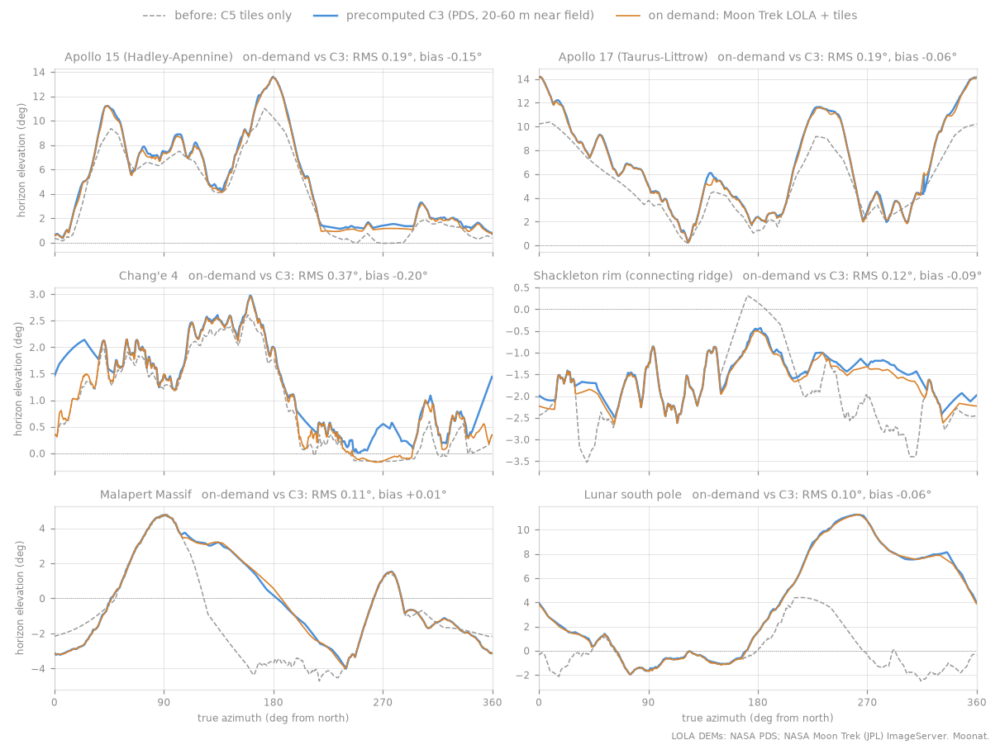
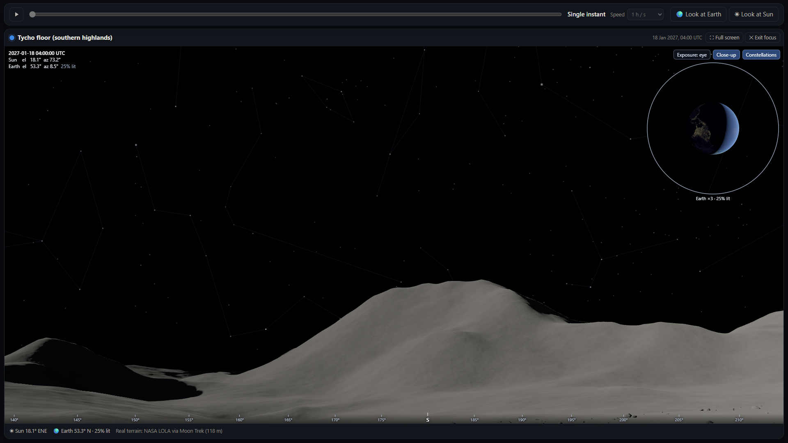
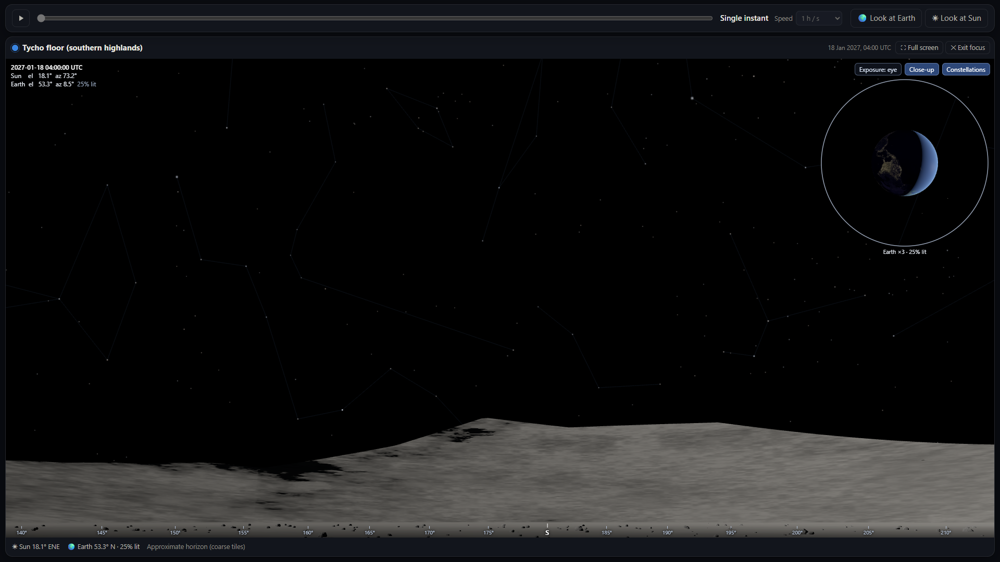
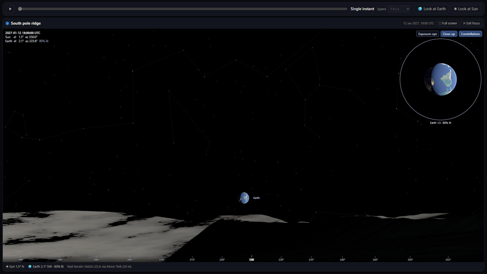

# Validation: on-demand terrain for any point (`web/js/terrain`, `terrainAt`)

> AI-generated with Claude Code (Anthropic), directed and reviewed by the Moonat team.
> Branch `shay/terrain-everywhere`, 2026-11-14. Research and design: [docs/research/terrain-everywhere.md](../research/terrain-everywhere.md).
> Domains: the horizon maths and the Sun statistics are Shay's; the data source, caching and network costs are Shahar's (pending her review).
>
> **Reproduce:**
> 1. `node scripts/data/validate_terrain_everywhere.mjs` (live, needs trek.nasa.gov);
> 2. `uv run python scripts/data/validate_terrain_everywhere.py` (Sun statistics and figure);
> 3. `node --test web/tests/` (offline checks).
>
> **Numbers:** in [terrain_everywhere.json](terrain_everywhere.json).

## 1. What is compared
For each catalog site, three horizons (2 m eye, 0.25° azimuth step):
- **C3:** the precomputed profile in `web/data/horizons/`.
  - Near field: SLDEM2015 59 m (|lat| < 60°) or LOLA 20 m / 60 m polar.
  - Mid field: LDEM_64 or LOLA 240 m. Far field: LDEM_16.
- **On demand:** `computeTerrain` (= `terrainAt` without the worker).
  - Near and mid field: Moon Trek LOLA grids of 401² px in the site-centred stereographic plane. They are 20 m / 80 m / 320 m (85–90°S), 30 m / 120 m / 480 m (75–85°) or 118 m / 474 m (elsewhere).
  - Far field: the shipped C5 tiles.
- **Tiles only:** the C5 tiles (what custom points get today from `horizonFromTiles`).

"Error" means on demand minus C3, in degrees of elevation, over all 1440 azimuths.

## 2. Horizon accuracy
| Site | lat, lon | Near-field cell | **On demand vs C3**: RMS / bias / max | Same, only where C3 is set > 5 km away: RMS / bias | Tiles only vs C3: RMS / bias | Ground (m): on demand / C3 | Patch vs C4 (m): RMS / bias |
|---|---|---|---|---|---|---|---|
| Apollo 11 (Tranquility Base) | 0.67, 23.47 | 118 m | **1.14** / −1.00 / 2.22 | — (all < 5 km) | 1.31 / −1.20 | −1926.6 / −1929.5 | 6.6 / −2.4 |
| Apollo 15 (Hadley-Apennine) | 26.13, 3.63 | 118 m | **0.19** / −0.15 / 0.51 | 0.16 / −0.12 | 1.21 / −1.00 | −1925.8 / −1928.3 | 24.1 / +0.3 |
| Apollo 16 (Descartes Highlands) | −8.97, 15.50 | 118 m | **0.95** / −0.54 / 2.77 | 0.09 / −0.06 | 1.71 / −1.37 | 13.0 / 12.1 | 14.2 / −0.4 |
| Apollo 17 (Taurus-Littrow) | 20.19, 30.77 | 118 m | **0.19** / −0.06 / 1.53 | 0.19 / −0.06 | 1.76 / −1.40 | −2627.6 / −2627.3 | 28.4 / −0.2 |
| Surveyor 7 (Tycho rim, mid-latitude highland) | −40.98, −11.51 | 118 m | **0.14** / −0.02 / 0.45 | 0.09 / −0.05 | 2.75 / −2.39 | 69.7 / 70.5 | 10.5 / +0.9 |
| Chang'e 4 (Von Kármán) | −45.46, 177.59 | 118 m | **0.37** / −0.20 / 1.26 | 0.05 / −0.03 | 0.47 / −0.36 | −5926.1 / −5928.6 | 5.7 / −1.8 |
| Chandrayaan-3 | −69.37, 32.32 | 118 m | **0.07** / −0.03 / 0.26 | 0.02 / −0.01 | 0.51 / −0.41 | 529.4 / 529.0 | 4.7 / +0.1 |
| Shackleton rim (connecting ridge) | −89.44, −137.19 | 20 m | **0.12** / −0.09 / 0.30 | 0.02 / −0.01 | 0.76 / −0.30 | 1958.5 / 1958.0 | 1.3 / −0.3 |
| Malapert Massif | −85.99, 0.12 | 20 m | **0.11** / +0.01 / 0.43 | 0.02 / −0.01 | 2.26 / −1.08 | 4843.3 / 4843.1 | 1.4 / +0.0 |
| Lunar south pole (exact) | −90.00, 0.00 | 20 m | **0.10** / −0.06 / 0.64 | 0.05 / −0.04 | 5.62 / −3.93 | 1290.4 / 1290.1 | 1.4 / −0.3 |
| Haworth (Artemis III candidate) | −86.96, −24.17 | 20 m | **0.07** / −0.03 / 0.34 | 0.01 / −0.00 | 1.10 / −0.61 | 1808.8 / 1808.6 | 1.2 / −0.0 |
| de Gerlache rim | −89.01, −96.65 | 20 m | **0.17** / −0.10 / 0.41 | 0.02 / −0.01 | 1.11 / −0.57 | 1551.9 / 1551.5 | 1.2 / −0.5 |

**Reading the table:**
- **Polar sites (20 m, same LOLA family as C3):**
  - The error is 0.07–0.17° RMS with a bias of −0.03 to −0.10°.
  - It is 0.01–0.05° RMS where the horizon is set more than 5 km away.
  - The terrain patches agree to 1.2–1.4 m RMS.
  - The old tiles-only horizons were 0.8–5.6° RMS off. The exact south pole was the worst case: the tiles missed the 11° wall to the west.
- **Low and mid latitudes:**
  - Where the horizon is set by valley walls, massifs or crater rims (Apollo 15, Apollo 17, Surveyor 7, Chang'e 4, Chandrayaan-3), the error is 0.07–0.37° RMS. It is 0.02–0.19° RMS beyond 5 km.
  - The remaining error is the near field. Moon Trek offers LOLA-only 118 m here, while C3 uses SLDEM2015 at 59 m, and SLDEM2015 is not readable from a browser (research doc §a).
- **Apollo 11 and Apollo 16 (the two outliers):**
  - **Cause:** on a flat mare, or in gently rolling highlands, the horizon is set by terrain 0.1–1 km away. C3 picks up 1–3 m bumps from SLDEM2015 there, and these are at the DEM's noise level (docs/validation/terrain.md §7).
  - **Check:** ignoring terrain closer than 500 m in both horizons brings Apollo 11 to 0.34° RMS (bias −0.28°) and Apollo 16 to 0.16° RMS (bias −0.08°). The mean horizons are then 0.16° vs 0.43° and 1.87° vs 1.95°.
  - **Reading:** at these sites the C3 horizon itself is uncertain by about as much as the on-demand difference.
- **Bias:** every site is low-biased (−0.01 to −0.20° where the near field is resolved). A 118 m or 20 m grid that the server resamples, plus our bilinear interpolation, slightly flattens peaks. This was 1.0–3.9° for the old tiles.
- **Ground heights** agree within 0.2–3 m. Patches at low latitudes differ by 5–28 m RMS, mostly on steep slopes, because LOLA 118 m and SLDEM2015 59 m are different products. The georeferencing test below rules out an offset.

## 3. Sun visibility over one lunar month (polar sites)
- **Sun position:** moonat.ephem.direct (skyfield + DE421 + MOON_ME), topocentric, every 1 h over one synodic month.
- **Disk fraction:** moonat.visibility.
- **Months:** January 2027 (high Sun at the south pole) and July 2027 (low Sun).
- **Two measures:**
  - "vis %" = the share of hours with any part of the disk visible (C6 `sun_vis_pct`);
  - "mean %" = the time-averaged visible fraction of the disk.

| Site | Month | C3 vis % / mean % | **On demand** vis % / mean % | Tiles only vis % / mean % |
|---|---|---|---|---|
| Shackleton rim | 2027-01 | 100.0 / 100.0 | **100.0 / 100.0** | 100.0 / 95.7 |
| | 2027-07 | 94.8 / 88.9 | **95.3 / 90.1** | 87.3 / 84.7 |
| Malapert Massif | 2027-01 | 54.3 / 53.1 | **54.9 / 53.5** | 76.3 / 74.0 |
| | 2027-07 | 47.8 / 45.9 | **47.8 / 46.1** | 52.6 / 49.6 |
| Lunar south pole | 2027-01 | 35.4 / 33.5 | **35.8 / 33.9** | 79.8 / 77.1 |
| | 2027-07 | 24.5 / 18.4 | **24.8 / 19.7** | 61.1 / 49.8 |
| Haworth | 2027-01 | 84.1 / 81.1 | **84.1 / 81.2** | 82.9 / 79.6 |
| | 2027-07 | 52.3 / 43.4 | **53.6 / 44.5** | 53.6 / 46.7 |
| de Gerlache rim | 2027-01 | 85.9 / 79.8 | **89.3 / 83.1** | 96.6 / 93.7 |
| | 2027-07 | 64.0 / 59.9 | **65.9 / 61.4** | 76.7 / 69.5 |

**Result:**
- On demand vs C3: within 0–1.3 points (vis %) and 0–1.3 points (mean %) at four of the five sites.
- de Gerlache rim: +1.9 to +3.4 points. There the Sun grazes a horizon about 0.1° lower than C3's.
- Tiles only: the error was up to 44 points (the south pole in January).

## 4. Offline checks (`node --test web/tests/`, no network)
`web/tests/terrain_lerc.test.mjs` and `web/tests/terrain_everywhere.test.mjs`:

| Check | Result |
|---|---|
| LERC 1 decoder vs the uncompressed `bsq` output of the same 5 Moon Trek requests (fixtures captured live; one half outside the layer, so with a validity mask) | every value within the tolerance (0.02 / 0.05 m), identical mask |
| March over the C5 tiles alone vs `horizonFromTiles` (6 Python-reference sites) | identical: el, dist, ground, range |
| Smooth sphere through three nested grids (lat 10°, −89.5°, −90°; eye 2 m and 10 m) | el = −acos(ρ/(ρ+h)) within the 1e-4° output rounding; distance √(2ρh) within 30 m |
| Gaussian hill (2 km high, σ = 3 km, 15 km away at az 60°) sampled into the grids, vs a dense (2 m) brute-force march of the analytic surface | within 0.005° at az 45–75° |
| Patch on a sphere | z = √((R+H)² − s²) − (R+H) within 1 mm |
| Stereographic plane vs the ray geometry (6 sites incl. both poles) | x = r sin A, y = r cos A, r = 2R tan(θ/2), to 1e-6 m |
| **Georeferencing:** Moon Trek grid vs the shipped C4 patch, RMS height difference minimised over shifts up to ±200 m | Shackleton rim: 1.07 m RMS, best shift (0, 0); exact south pole: 1.38 m, (0, 0); Apollo 15 (118 m LOLA vs 59 m SLDEM2015): 24.8 m, (−10, 0) m |

## 5. Timing and bytes (cold load of a new point)
**Fresh random points**, new on every run so that no cache helps (2026-11-14, about 16:45 Israel time):
- **Network + compute:** 1.0–1.3 s at |lat| < 60° and 0.95–2.9 s at 75–90°.
- **Compute:** ray march + patch take 50–80 ms in Node. Decoding LERC adds 2–3 ms per 401² grid.
- **A busy server:** earlier the same day, the same kind of points took 3.3–4.5 s.

| Band | Moon Trek requests | Moon Trek bytes | C5 tile bytes (first visit to the region only, then HTTP-cached) |
|---|---|---|---|
| \|lat\| < 60° | 2 | 0.50–0.53 MB | 0.11–0.68 MB |
| 75–85°S / 75–90°N (30 m) | 3 | 0.68–0.73 MB | 4.8 MB south (south480 + global8 row) / 1.4 MB north |
| 85–90°S (20 m) | 3 | 0.68–0.74 MB | (same south set) |

- **The old way:** tiles only took 4–50 ms of compute (Node, tiles on local disk) and fetched 0.1–4.8 MB of tiles, with no Moon Trek requests.
- **In the browser:** `terrainAt` runs the whole job in a module Web Worker, so the page stays responsive.

### 5.1 In the live app (Microsoft Edge, `scripts/check_terrain_live.py`, 1920 × 1080)
The site is served locally; the points are opened through a shared `#s=` link, which takes the same scenario path as a map
click or typed coordinates.

| Check | Result |
|---|---|
| Tycho floor, −43.0°, −11.36° (southern highlands; central peak 13.4° high, 9.8 km south) | "Real terrain: NASA LOLA via Moon Trek (118 m)" 2.8 s after page load; 2 requests, 0.53 MB; one Web Worker; no console errors |
| South-pole ridge, −89.3°, 130° (not in the catalog) | "Real terrain … (20 m)" 2.5–5.3 s after page load; 3 requests, 0.74 MB; no console errors |
| Rapid edits: latitude retyped 4 times, 0.8 s apart | 8 superseded `exportImage` requests cancelled, only the last point's 2 complete; final status "Real terrain" |
| trek.nasa.gov blocked (DNS mapped to a closed port, which also covers the worker) | "Approximate horizon (coarse tiles)" after 1.2 s; the coarse skyline is drawn; the only console errors are the refused connections |
| A stalled server request (seen once: 31 s, then only the 474 m level) | now 12 s timeout + one retry per grid (`web/tests/terrain_live.test.mjs`) |

*Tycho floor with live Moon Trek terrain (Sun 18° ENE, looking south at the central peak).*

*The same view when Moon Trek cannot be reached: the 3.8 km tiles lose the central peak.*

*−89.3°, 130°: Sun 1.5° up behind the camera, Earth 2.1° up in the south-west, 20 m LOLA ground.*

## 6. Limits
- **Low-latitude near field:** it is LOLA 118 m, not SLDEM2015 59 m. Where the horizon is set within about 1 km (flat mare), the result can differ from C3 by about 1°. That is the same size as the DEM-noise sensitivity of C3 itself.
- **No SLA:** Moon Trek has no SLA. A failure falls back to the tiles (`meta.fallback`, `horizon.approximate = true`).
- **North pole:** at 75–90°N the far field uses global8 only (there is no north480 level).
- **Latency:** it depends on the server's load (1–4.5 s measured).
